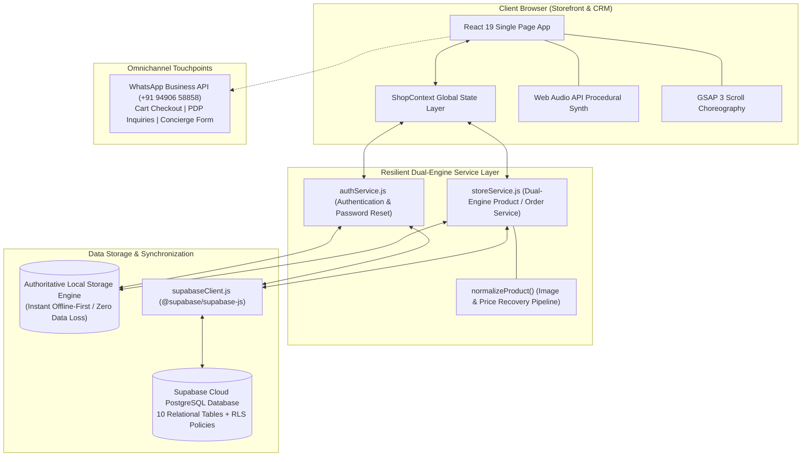
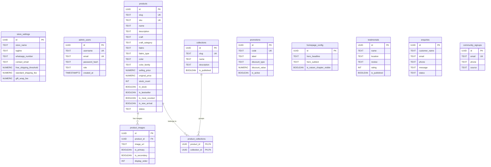

# RODHE — Woven with Trust
### High-Fashion Slow-Luxury Cotton Saree E-Commerce Maison & Client CRM Suite

[](https://react.dev/)
[](https://vitejs.dev/)
[](https://supabase.com/)
[](https://greensock.com/gsap/)
[](#-storefront-features--customer-experience)
[](https://wa.me/919490658858)
[](#-provenance--copyright)

> **The Creative Concept Chain**:  
> *Nature → Cotton → Thread → Natural Colour → Handcrafted Patterns → Saree → RODHE*  
>
> **Brand Hallmark**:  
> 100% Pure Indian Cotton, Generational Teakwood Handblock Printing, Fermented Botanical Dyes, Honest Artisan Direct-to-Consumer Pricing (₹500 – ₹2,000), and an Integrated Administrative CRM & Inventory Control Suite.

---

## 📑 Table of Contents

1. [Brand Philosophy & Executive Summary](#-brand-philosophy--executive-summary)
2. [Complete System Architecture](#-complete-system-architecture)
3. [Technology Stack Matrix](#-technology-stack-matrix)
4. [Dual-Engine Persistence Engine (Supabase + Local)](#-dual-engine-persistence-engine-supabase--local)
5. [Frontend Storefront Master Guide (Customer Experience)](#-frontend-storefront-master-guide-customer-experience)
   - [5.1 Cinematic Scroll-Driven Cloud Intro & Web Audio Synth](#51-cinematic-scroll-driven-cloud-intro--web-audio-synth)
   - [5.2 Editorial Video Hero & Announcement Bar](#52-editorial-video-hero--announcement-bar)
   - [5.3 Craft Marquee Advertisement Ribbon](#53-craft-marquee-advertisement-ribbon)
   - [5.4 Curated Discovery Chapters (Colour, Craft, Bestsellers)](#54-curated-discovery-chapters-colour-craft-bestsellers)
   - [5.5 "Find Your Piece" Budget Navigation](#55-find-your-piece-budget-navigation)
   - [5.6 Saree Atelier & 50-Product Catalog (`CollectionPage`)](#56-saree-atelier--50-product-catalog-collectionpage)
   - [5.7 Interactive Product Detail Page (`ProductDetailPage`)](#57-interactive-product-detail-page-productdetailpage)
   - [5.8 Slide-Over Shopping Bag Drawer (`CartDrawer`)](#58-slide-over-shopping-bag-drawer-cartdrawer)
   - [5.9 Wishlist Keepsake Drawer (`WishlistDrawer`)](#59-wishlist-keepsake-drawer-wishlistdrawer)
   - [5.10 Indian Multi-Step Checkout Modal (`CheckoutModal`)](#510-indian-multi-step-checkout-modal-checkoutmodal)
   - [5.11 Quick View & Global Instant Search Modals](#511-quick-view--global-instant-search-modals)
   - [5.12 Brand Story Manifesto (`BrandStoryPage`)](#512-brand-story-manifesto-brandstorypage)
   - [5.13 Contact & Styling Concierge (`ContactConciergePage`)](#513-contact--styling-concierge-contactconciergepage)
6. [Image Delivery & Normalization Engine](#-image-delivery--normalization-engine)
7. [Price Calculation & Financial Safeguards](#-price-calculation--financial-safeguards)
8. [WhatsApp Business Concierge Integration (`9490658858`)](#-whatsapp-business-concierge-integration-9490658858)
9. [Administrative Client CRM & Boutique Management Suite](#-administrative-client-crm--boutique-management-suite)
   - [9.1 Access & Role-Based Authentication](#91-access--role-based-authentication)
   - [9.2 Forgot Password & In-Dashboard Security](#92-forgot-password--in-dashboard-security)
   - [9.3 Module 1: Executive Dashboard & Live KPIs](#93-module-1-executive-dashboard--live-kpis)
   - [9.4 Module 2: Saree Inventory Management](#94-module-2-saree-inventory-management)
   - [9.5 Module 3: Saree Creation & In-Browser Image Compressor](#95-module-3-saree-creation--in-browser-image-compressor)
   - [9.6 Module 4: Bulk CSV Data Ingestion & Schema Template](#96-module-4-bulk-csv-data-ingestion--schema-template)
   - [9.7 Module 5: Collections & Merchandising](#97-module-5-collections--merchandising)
   - [9.8 Module 6: Homepage CMS & Banner Customizer](#98-module-6-homepage-cms--banner-customizer)
   - [9.9 Module 7: Promotions & Coupon Engine](#99-module-7-promotions--coupon-engine)
   - [9.10 Module 8: Patron Reviews & Testimonials](#910-module-8-patron-reviews--testimonials)
   - [9.11 Module 9: Concierge Customer Inquiries](#911-module-9-concierge-customer-inquiries)
   - [9.12 Module 10: Store Global Settings](#912-module-10-store-global-settings)
10. [Database Architecture & PostgreSQL Schema (Supabase)](#-database-architecture--postgresql-schema-supabase)
    - [10.1 Table Breakdown & Definitions](#101-table-breakdown--definitions)
    - [10.2 Row Level Security (RLS) Policies](#102-row-level-security-rls-policies)
    - [10.3 Performance Indexes](#103-performance-indexes)
    - [10.4 SQL Migrations & Data Population Scripts](#104-sql-migrations--data-population-scripts)
11. [Master Product Catalog (50 Pure Cotton Handloom Sarees)](#-master-product-catalog-50-pure-cotton-handloom-sarees)
12. [Design System, Typography & CSS Design Tokens](#-design-system-typography--css-design-tokens)
13. [Complete Codebase Directory Inventory](#-complete-codebase-directory-inventory)
14. [Local Development, Build & Deployment Guide](#-local-development-build--deployment-guide)
15. [Troubleshooting & Frequently Asked Questions (FAQ)](#-troubleshooting--frequently-asked-questions-faq)
16. [Provenance & Copyright](#-provenance--copyright)

---

## 🌿 Brand Philosophy & Executive Summary

**RODHE** is an Indian slow-luxury fashion maison and full-scale e-commerce platform dedicated exclusively to pure handloom cotton sarees. Rooted in the living relationship between Indian soil, generational weavers, and discerning patrons, RODHE removes conventional retail middlemen to offer authentic heirloom cotton sarees strictly within an accessible **₹500 to ₹2,000** price point.

### The Artisan Value Model
```
┌────────────────────────────────────────────────────────────────────────┐
│                        THE RODHE ARTISAN JOURNEY                       │
├──────────────┬──────────────┬──────────────┬──────────────┬────────────┤
│    NATURE    │    COTTON    │    THREAD    │ NATURAL DYES │   PATRON   │
│  Rain-fed    │ Hand-picked  │ Spun on      │ Indigo, Dabu │ Direct D2C │
│ Deccan Soil  │ Organic Boll │ Charkha Loom │ Madder Root  │ Doorstep   │
└──────────────┴──────────────┴──────────────┴──────────────┴────────────┘
```

The application is structured into two harmonized portals:
1. **The Storefront**: An editorial, high-fashion customer experience featuring procedural Web Audio, a billowing cloud scroll intro, multi-attribute filtering, high-resolution galleries, slide-over bag and wishlist drawers, multi-step Indian checkout, and direct WhatsApp ordering.
2. **The Client CRM Suite (`/#admin`)**: A private management workspace for boutique owners to manage live inventory, upload sarees, monitor low-stock alerts, import CSVs, customize homepage copy, create discount coupons, manage inquiries, and configure store settings.

---

## 🏛️ Complete System Architecture

RODHE is engineered as a zero-latency Single Page Application (SPA) utilizing React 19, Vite 8, and Supabase PostgreSQL.



---

## 🛠️ Technology Stack Matrix

| Layer | Technology | Version | Purpose |
|---|---|---|---|
| **Core Framework** | [React](https://react.dev/) | `^19.3.1` | Concurrent rendering, UI components, custom hooks, and context state management. |
| **DOM Engine** | [React DOM](https://react.dev/) | `^19.3.1` | Native browser DOM mounting and portal rendering for drawers and modals. |
| **Build & Dev Tool** | [Vite](https://vitejs.dev/) | `^8.3.4` | Ultra-fast HMR development server and optimized Rollup production bundler. |
| **Linter & Analyzer** | [Oxlint](https://oxc.rs/) | `^1.88.0` | High-performance Rust-based JavaScript and React linter. |
| **Database & Cloud** | [Supabase](https://supabase.com/) | `^2.118.0` | Managed PostgreSQL database, authentication, storage buckets, and realtime APIs. |
| **SSR Adapter** | `@supabase/ssr` | `^0.12.7` | Isomorphic cookie and session management adapter for Supabase. |
| **Animation Engine** | [GSAP](https://greensock.com/gsap/) | `^3.15.0` | High-precision scroll choreography, emblem translation, and cinematic cloud parting. |
| **Audio Synthesis** | Web Audio API | *Native* | Procedural sound design: 60Hz ambient drone, lowpass silk whoosh, and pentatonic tonal chime. |
| **Icons & Visuals** | [Lucide React](https://lucide.dev/) | `^1.59.0` | Clean, modern featherweight vector iconography. |
| **Delight Engine** | [Canvas Confetti](https://www.npmjs.com/package/canvas-confetti) | `^1.9.4` | Physics-based particle confetti burst on successful checkout order submission. |
| **Typography** | Google Fonts | CDN | Cormorant Garamond (Editorial Serif), Marcellus (Hallmark), Plus Jakarta Sans (Body). |

---

## ⚡ Dual-Engine Persistence Engine (Supabase + Local)

A signature technical implementation of RODHE is its **Dual-Engine Persistence Architecture** across [`storeService.js`](file:///c:/Users/VARUN%20THEJ/OneDrive/Desktop/Rodhe/src/services/storeService.js) and [`authService.js`](file:///c:/Users/VARUN%20THEJ/OneDrive/Desktop/Rodhe/src/services/authService.js):

### Why Dual-Engine?
1. **Zero Data Loss**: In client-side setups, remote database network dropouts or PostgreSQL Row Level Security (RLS) restrictions can silently discard writes from anonymous API keys.
2. **Immediate UI Responsiveness**: Changes made in the CRM (such as editing a saree, updating stock, changing a password, or creating a promotion) take effect in the browser instantly without waiting for network roundtrips.
3. **Automatic Merging**: When querying products, `storeService.getProducts()` reads the authoritative local store and merges remote database rows. If a database record lacks fields or images, the local normalizer reconstructs the missing attributes seamlessly.

```javascript
// Dual-Engine write flow in storeService.js
async saveProduct(product) {
  const normalized = normalizeProduct(product);
  
  // 1. Authoritative Local Storage update
  const localProducts = getLocalData(STORAGE_KEYS.PRODUCTS, SEED_PRODUCTS);
  const updated = [normalized, ...localProducts.filter(p => p.id !== normalized.id)];
  setLocalData(STORAGE_KEYS.PRODUCTS, updated);

  // 2. Asynchronous Cloud Database Synchronization
  if (isSupabaseConfigured && supabase) {
    try {
      await supabase.from('products').upsert(dbPayload, { onConflict: 'sku' });
    } catch (err) {
      console.warn('Supabase synchronization warning:', err.message);
    }
  }
  return normalized;
}
```

---

## 🛍️ Frontend Storefront Master Guide (Customer Experience)

### 5.1 Cinematic Scroll-Driven Cloud Intro & Web Audio Synth
- **Component**: [`ScrollIntroExperience.jsx`](file:///c:/Users/VARUN%20THEJ/OneDrive/Desktop/Rodhe/src/components/ScrollIntroExperience.jsx)
- **Visual Choreography**:
  - Starts with an immersive `#1A1412` dark veil with the authentic brand emblem (`/assets/01_Primary_logo_transparent.png`).
  - Billowing silk cloud layers (`cloud_layer_left.jpg`, `cloud_layer_right.jpg`, `cloud_layer_center.jpg`) float and swell.
  - As the user scrolls (mouse wheel, touch swipe, down-arrow, or screen tap), GSAP animates the left and right clouds parting laterally to reveal the real website underneath.
  - The central emblem scales down and glides precisely into the navbar logo coordinates.
- **Procedural Audio Engine**:
  - Built-in Web Audio API synthesizes a cinematic audio landscape without requiring external MP3 audio files:
    - **60 Hz Warm Ambient Drone**: Dual oscillator with low-pass filter providing luxury resonance.
    - **Silk Swell Whoosh**: White noise buffer routed through an exponential frequency sweep filter.
    - **Pentatonic Logo Chime**: Triangle wave chime at 523.25 Hz (C5) and 659.25 Hz (E5) upon full reveal.
  - Audio starts automatically upon interaction if enabled, with persistent Mute/Unmute toggle and an instant **"Skip to Boutique"** button.

### 5.2 Editorial Video Hero & Announcement Bar
- **Component**: [`HeroSection.jsx`](file:///c:/Users/VARUN%20THEJ/OneDrive/Desktop/Rodhe/src/components/HeroSection.jsx)
- **Features**:
  - High-definition ambient video loop (`/assets/Herosection-RODHE.mp4`) with subtle dark gradient vignette.
  - Video play/pause and sound unmute controls.
  - Editorial headline: *"Born from Nature. Made to Be Worn."*
  - Trust Badges: 100% Pure Rain-fed Cotton, Heritage Teakwood Blocks, Fermented Botanical Dyes, and Direct Artisan Craftsmanship.
  - Direct navigation button to `#collections`.

### 5.3 Craft Marquee Advertisement Ribbon
- **Component**: [`CraftMarquee.jsx`](file:///c:/Users/VARUN%20THEJ/OneDrive/Desktop/Rodhe/src/components/CraftMarquee.jsx)
- **Features**:
  - Smooth infinite horizontal ticker banner in heritage gold (`#B88D4A`) and earth brown.
  - Highlights core services:
    - *100% Pure Cotton Handloom Sarees (Mulmul, Kota Doria, Chanderi)*
    - *Authentic Hand Block Printing (Bagru, Dabu Mud-Resist, Ajrakh)*
    - *Customized Block Printing & Dyeing on Demand (Direct WhatsApp link)*
    - *Natural Botanical Pigments (Indigo, Madder Root, Earth Clay)*
  - Pauses dynamically on hover; clicking any marquee item opens collections or triggers a prefilled WhatsApp inquiry.

### 5.4 Curated Discovery Chapters (Colour, Craft, Bestsellers)
- **Shop By Colour** ([`ShopByColourSection.jsx`](file:///c:/Users/VARUN%20THEJ/OneDrive/Desktop/Rodhe/src/components/ShopByColourSection.jsx)):
  - Explores sarees categorized by botanical color families: Natural Indigo, Madder Crimson, Earth Ochre, Forest Olive, Raw Ivory, and Muted Gold.
  - Clicking a swatch automatically sets `selectedColor` in `ShopContext` and navigates to the boutique collection.
- **Shop By Craft** ([`ShopByCraftSection.jsx`](file:///c:/Users/VARUN%20THEJ/OneDrive/Desktop/Rodhe/src/components/ShopByCraftSection.jsx)):
  - Showcases craft guilds: Bagru Mud-Resist, Natural Shibori & Tie-Dye, Sheer Chanderi Weaves, and Breathable Mulmul.
- **Product Grid Tabs** ([`ProductGrid.jsx`](file:///c:/Users/VARUN%20THEJ/OneDrive/Desktop/Rodhe/src/components/ProductGrid.jsx)):
  - Switches between "Patron Bestsellers", "Most Coveted", and "Fresh from the Loom" with animated pill indicators.

### 5.5 "Find Your Piece" Budget Navigation
- **Component**: [`FindYourPieceSection.jsx`](file:///c:/Users/VARUN%20THEJ/OneDrive/Desktop/Rodhe/src/components/FindYourPieceSection.jsx)
- **Budget Brackets**:
  - **Under ₹800**: Everyday breathable mulmul cotton drapes.
  - **₹800 – ₹1,200**: Artisanal mud-resist block prints and daily wear handlooms.
  - **₹1,200 – ₹1,600**: Fermented botanical indigo shibori and fine Kota Doria.
  - **₹1,600 – ₹2,000**: Heirloom Chanderi silk-cotton and intricate ceremonial zari borders.
  - Clicking any budget card filters the master catalog instantly.

### 5.6 Saree Atelier & 50-Product Catalog (`CollectionPage`)
- **Component**: [`CollectionPage.jsx`](file:///c:/Users/VARUN%20THEJ/OneDrive/Desktop/Rodhe/src/components/CollectionPage.jsx)
- **Features**:
  - Filter Drawer & Desktop Sidebar: Filter by Craft Guild, Botanical Color, Fabric Type, In-Stock status, and Dynamic Price Slider (₹500 to ₹2,000).
  - Search Bar: Real-time search across saree names, descriptions, SKUs, and crafts.
  - Sort Engine: Featured, Price: Low to High, Price: High to Low, Customer Rating, and Newest Arrivals.
  - Dynamic Result Counter and "Reset Filters" pill.
  - 4-column responsive grid on desktop, 2-column on tablet/mobile, and 1-column on compact viewports.

### 5.7 Interactive Product Detail Page (`ProductDetailPage`)
- **Component**: [`ProductDetailPage.jsx`](file:///c:/Users/VARUN%20THEJ/OneDrive/Desktop/Rodhe/src/components/ProductDetailPage.jsx)
- **Features**:
  - **Gallery**: High-resolution zoomable image viewer with thumbnail picker and error-recovery fallback.
  - **Textile Specifications**: Exact dimensions (6.5m length, 45" width), fabric type, craft guild, and blouse piece status.
  - **Blouse Piece Hallmark**: Explicitly highlights: *"Included — Matching unstitched 80cm pure cotton fabric with running border"*.
  - **Wash & Care Guide**: Botanical dye instructions (first wash dry clean, subsequent gentle cold water wash).
  - **Direct WhatsApp Inquiry Button**: Generates a tailored WhatsApp message quoting the saree's name, SKU, price, and image.
  - **Mobile Sticky Action Bar**: Pinned to the bottom of mobile screens with unit price, Wishlist heart, and "Add to Bag" button.

### 5.8 Slide-Over Shopping Bag Drawer (`CartDrawer`)
- **Component**: [`CartDrawer.jsx`](file:///c:/Users/VARUN%20THEJ/OneDrive/Desktop/Rodhe/src/components/CartDrawer.jsx)
- **Features**:
  - Slide-out right drawer with backdrop blur.
  - Dynamic free shipping progress bar calibrated to the ₹2,999 threshold (displays remaining amount needed).
  - Quantity controls (`+` / `-`) and item removal.
  - Heritage keepsake gift packaging toggle (+₹150).
  - Coupon code input with live validation (`WOVEN10` for 10% off, `RODHE15` for 15% off).
  - Dual Checkout Triggers:
    - **"Proceed to Checkout"**: Opens the Indian multi-step checkout modal.
    - **"Order via WhatsApp"**: Generates a complete order draft directly into WhatsApp.

### 5.9 Wishlist Keepsake Drawer (`WishlistDrawer`)
- **Component**: [`WishlistDrawer.jsx`](file:///c:/Users/VARUN%20THEJ/OneDrive/Desktop/Rodhe/src/components/WishlistDrawer.jsx)
- **Features**:
  - Displays all patron-saved sarees persisted in `localStorage` (`rodhe_wishlist`).
  - One-click "Move to Bag" and "Remove" actions.
  - Quick link to explore the collection when empty.

### 5.10 Indian Multi-Step Checkout Modal (`CheckoutModal`)
- **Component**: [`CheckoutModal.jsx`](file:///c:/Users/VARUN%20THEJ/OneDrive/Desktop/Rodhe/src/components/CheckoutModal.jsx)
- **Steps**:
  1. **Patron Details**: Full name, email address, and 10-digit phone number.
  2. **Delivery Address**: Street address, city, state, and 6-digit Indian Postal PIN code with real-time format validation.
  3. **Shipping Method**: Insured Express Air Courier (Free for ₹2,999+) or Standard Surface.
  4. **Payment Options**: UPI (Google Pay, PhonePe, Paytm, BHIM), Credit/Debit Cards, Net Banking, and Cash on Delivery (COD).
- **Celebratory Confirmation**:
  - Triggers a physics-driven multi-color `canvas-confetti` explosion upon submission.
  - Displays order reference ID, summary recap, and provides an instant "Share to WhatsApp" receipt button.

### 5.11 Quick View & Global Instant Search Modals
- **Quick View** ([`ProductQuickViewModal.jsx`](file:///c:/Users/VARUN%20THEJ/OneDrive/Desktop/Rodhe/src/components/ProductQuickViewModal.jsx)): Modal preview showing images, price, craft details, and fast "Add to Bag" without leaving the catalog.
- **Search Modal** ([`SearchModal.jsx`](file:///c:/Users/VARUN%20THEJ/OneDrive/Desktop/Rodhe/src/components/SearchModal.jsx)): Full-screen search overlay with instant keystroke matching across all 50 sarees, displaying thumbnail previews, prices, and direct navigation links.

### 5.12 Brand Story Manifesto (`BrandStoryPage`)
- **Component**: [`BrandStoryPage.jsx`](file:///c:/Users/VARUN%20THEJ/OneDrive/Desktop/Rodhe/src/components/BrandStoryPage.jsx)
- **Content**:
  - Full editorial rendering of the 4 chapters:
    - *Chapter 01: Born from Nature (Rain-fed Deccan Cotton)*
    - *Chapter 02: Colours of the Earth (Fermented Botanical Indigo & Madder)*
    - *Chapter 03: The Art of Craft (Hand-carved Teakwood Blocks & Dabu Mud)*
    - *Chapter 04: A Saree Comes to Life (Heirloom Packaging & Care Paper)*
  - Artisan Guild spotlight, sustainability credentials, and trust manifesto.

### 5.13 Contact & Styling Concierge (`ContactConciergePage`)
- **Component**: [`ContactConciergePage.jsx`](file:///c:/Users/VARUN%20THEJ/OneDrive/Desktop/Rodhe/src/components/ContactConciergePage.jsx)
- **Features**:
  - Direct inquiry form with Name, Email, Phone, Subject dropdown, and Message.
  - Submitting saves the record to the backend inquiries table and dispatches a prefilled chat directly to the WhatsApp Concierge at `9490658858`.
  - Comprehensive customer FAQ accordion covering blouse fabrics, botanical wash instructions, and nationwide delivery timelines.
  - Atelier studio contact coordinates and concierge email.

### 5.14 Legal Policies & Patron Care (`LegalPolicyPage`)
- **Component**: [`LegalPolicyPage.jsx`](file:///c:/Users/VARUN%20THEJ/OneDrive/Desktop/Rodhe/src/components/LegalPolicyPage.jsx)
- **Features**:
  - Unified multi-tab legal policy viewer seamlessly accessible from the footer or direct URL hashes (`#policies`, `#shipping`, `#returns`, `#privacy`, `#terms`, `#care`).
  - **Shipping & Delivery Policy**: Insured express surface/air courier (Blue Dart, Delhivery, DTDC, India Post Speed Post), dispatched within 24–48 hours, tracking link dispatched via SMS & WhatsApp.
  - **7-Day Artisan Exchange & Returns**: Easy exchange for manufacturing defects or undamaged unworn drapes in original packaging; includes WhatsApp pickup concierge.
  - **DPDP Act 2023 Privacy Policy**: Complete compliance with the Digital Personal Data Protection Act 2023 (India), 256-bit encrypted data transit, zero third-party commercial sale of patron information.
  - **Terms of Service**: Handcrafted textile variations disclosure (charkha irregularities, natural dye tonal subtleties, teakwood block alignment variations are hallmarks of slow craftsmanship, not defects).
  - **Botanical Wash & Care Guide**: Step-by-step preservation guide for natural indigo, madder, and pomegranate peel dyes (cold water gentle dip, no chemical bleaching, shade dry inside out, medium warm iron).

---

## 🖼️ Image Delivery & Normalization Engine

To eradicate broken image icons, RODHE employs a **3-tier Image Normalization and Recovery Pipeline**:

```
┌───────────────────────────────────────────────────────────────┐
│               RODHE IMAGE RESOLUTION PIPELINE                 │
├───────────────────────────────────────────────────────────────┤
│ 1. Schema Harmonization:                                      │
│    Reads: p.product_images[0].image_url                       │
│       OR: p.product_images[0].url                             │
│       OR: p.primaryImage / p.primary_image                    │
│                                                               │
│ 2. Canonical Seed Matching:                                   │
│    Cross-matches p.sku or p.slug with SEED_PRODUCTS           │
│    in src/data/products.js to recover original studio photos  │
│                                                               │
│ 3. Craft & Color Fallback:                                    │
│    getCraftDefaultImage(craftCategory, colorFamily) resolves  │
│    verified high-resolution local assets:                     │
│    • Shibori/Indigo -> saree_indigo_shibori.jpg               │
│    • Bagru/Earth    -> saree_earth_bagru.jpg                  │
│    • Rose/Madder    -> saree_soft_rose.jpg                    │
│    • Olive/Forest   -> saree_forest_olive.jpg                 │
│    • Gold/Chanderi  -> saree_muted_gold.jpg                   │
│    • Mulmul/Default -> saree_ivory_mulmul.jpg                 │
│                                                               │
│ 4. Runtime Defensive Handling:                                │
│    All  tags feature onError={(e) => {                   │
│      e.currentTarget.onerror = null;                          │
│      e.currentTarget.src = '/assets/products/saree_ivory...'; │
│    }}                                                         │
└───────────────────────────────────────────────────────────────┘
```

---

## 💰 Price Calculation & Financial Safeguards

Every price calculation in RODHE complies with defensive engineering rules:

1. **Defensive Value Coercion**:
   ```javascript
   const unitPrice = Number(product.price ?? product.sellingPrice ?? product.selling_price ?? 990) || 990;
   ```
2. **Crash Prevention**: All invocations of `.toLocaleString('en-IN')` are shielded against `undefined`, `null`, or non-numeric inputs, guaranteeing zero runtime exceptions during filtering, search, or cart updates.
3. **Honest Handloom Price Architecture**: Every product in the active catalog is strictly priced in the **₹500 to ₹2,000** bracket. Artificial discount percentages and inflated strikethrough prices have been removed for clean luxury presentation.

---

## 📱 WhatsApp Business Concierge Integration (`9490658858`)

The official WhatsApp concierge line is deeply integrated across all touchpoints:

- **Official Number**: `+91 94906 58858`
- **Clean Digits**: `919490658858`
- **Direct API URL**: `https://wa.me/919490658858`

### Configured Touchpoints:
1. **Slide-Over Bag "Order via WhatsApp"**:
   - Formats every saree in the shopping bag into a clean itemized receipt:
   ```text
   Namaste RODHE Concierge,
   I would like to place an order for the following handcrafted sarees:

   • Nilambari Shibori Mulmul Saree (SKU: RDH-501) x 1 — ₹1,450
   • Mrittika Bagru Mud-Resist Saree (SKU: RDH-502) x 1 — ₹1,250

   • Subtotal: ₹2,700
   • Shipping: Complimentary Express Delivery
   • Heritage Gift Packaging: Yes (+₹150)
   • Grand Total: ₹2,850

   Please share bank transfer / UPI QR details and confirm delivery timeline.
   ```
2. **Product Detail Page "Enquire on WhatsApp"**:
   - Prefills the exact saree title, SKU code, unit price, and chosen quantity.
3. **Custom Printing & Dyeing Consultation**:
   - Marquee banner links patrons directly to custom block printing and dye consultations.
4. **Concierge Styling Form**:
   - Form submissions on the Contact page forward customer queries directly into WhatsApp.
5. **Top Announcement Bar**:
   - Displays: *"WhatsApp Concierge: +91 94906 58858"*.

---

## 🔐 Administrative Client CRM & Boutique Management Suite

The private administrative CRM suite is accessible directly from the header navigation by clicking the **"CRM Portal"** pill button or navigating directly to:
```
http://localhost:5173/#admin
```

### 9.1 Access & Role-Based Authentication
- **Default Username**: `rodhe`
- **Default Password**: `rodhe@admin`
- **Assigned Role**: `super_admin`
- **Authentication Service**: [`authService.js`](file:///c:/Users/VARUN%20THEJ/OneDrive/Desktop/Rodhe/src/services/authService.js) checks the database table `public.admin_users` with automatic failover to the local credentials store.
- **Session Persistence**: Stored under `rodhe_admin_session` in `localStorage`.

### 9.2 Forgot Password & In-Dashboard Security
- **Forgot Password Workflow**: Located on the login screen. Admins can enter username `rodhe` and specify a new password. The update is synced to the Supabase database and local session immediately.
- **In-Dashboard Password Change**: Located in **CRM Settings > Section 4 (Administrator Security & Password Management)**. Authenticated admins can update their credentials at any time.

---

### 9.3 Module 1: Executive Dashboard & Live KPIs
- **Component**: [`AdminDashboard.jsx`](file:///c:/Users/VARUN%20THEJ/OneDrive/Desktop/Rodhe/src/components/admin/AdminDashboard.jsx)
- **Live KPI Metric Cards**:
  - **Published Sarees**: Real-time count of active live catalog items.
  - **Draft Editions**: Sarees currently being crafted or photographed.
  - **Low Stock Warnings**: Automated indicator highlighting any saree with stock ≤ 5 pieces.
  - **Active Promotions**: Number of currently valid coupon codes.
  - **Concierge Inquiries**: Unread and total styling messages from patrons.
  - **Circle of Trust Signups**: Total newsletter email and phone signups.
- **Quick Action Bar**: Instant buttons to "Add New Saree", "Bulk CSV Upload", or "View Live Store".

---

### 9.4 Module 2: Saree Inventory Management
- **Component**: [`AdminProductList.jsx`](file:///c:/Users/VARUN%20THEJ/OneDrive/Desktop/Rodhe/src/components/admin/AdminProductList.jsx)
- **Capabilities**:
  - Live search by saree title, SKU, craft, or color family.
  - One-click status toggles:
    - **Published / Draft**: Instantly hide or reveal sarees on the storefront.
    - **Bestseller**: Feature in the "Patron Bestsellers" section.
    - **Most Coveted**: Feature in the "Most Coveted Masterpieces" section.
    - **New Arrival**: Highlight with the "Fresh from the Loom" indicator.
  - Stock Counter Editor: Fast increment/decrement of available pieces.
  - Edit & Delete: Complete control over every product record.

---

### 9.5 Module 3: Saree Creation & In-Browser Image Compressor
- **Component**: [`AdminProductForm.jsx`](file:///c:/Users/VARUN%20THEJ/OneDrive/Desktop/Rodhe/src/components/admin/AdminProductForm.jsx) & [`ImageUploadField.jsx`](file:///c:/Users/VARUN%20THEJ/OneDrive/Desktop/Rodhe/src/components/admin/ImageUploadField.jsx)
- **Form Fields**:
  - Name, auto-generated URL slug, SKU code, tagline, and full description.
  - Craft Guild, Craft Category, Fabric Name, and Fabric Type.
  - Color name, Botanical Color Family, and Hex Code picker.
  - Selling Price (₹500–₹2,000) and optional Original Price.
  - Dimensions, Blouse Piece specifications, and Wash Care instructions.
  - Stock Count and Merchandising badges.
- **Client-Side Image Compressor**:
  - Automatically resizes uploaded high-resolution photos in-browser using HTML5 Canvas to a maximum of 1600px width/height.
  - Converts images to compressed WebP (88% quality) or JPEG data URLs.
  - Eliminates server upload payload size errors while maintaining crystal-clear drape details.

---

### 9.6 Module 4: Bulk CSV Data Ingestion & Schema Template
- **Component**: [`AdminBulkImport.jsx`](file:///c:/Users/VARUN%20THEJ/OneDrive/Desktop/Rodhe/src/components/admin/AdminBulkImport.jsx)
- **Features**:
  - One-click downloadable CSV template (`RODHE_Saree_Import_Template.csv`).
  - Drag-and-drop CSV upload or paste raw CSV text.
  - Strict row validation checking for required fields (`name`, `sku`, `price`, `craft`).
  - Batch ingestion into `storeService` with real-time progress bar.

#### CSV Schema Structure:
```csv
name,sku,originalPrice,sellingPrice,craft,craftCategory,fabric,color,colorFamily,stockCount,primaryImage,tagline
"Vanamali Forest Olive Pure Cotton Saree",RODHE-OLV-001,1650,1250,"Chanderi Weave",chanderi,"Handwoven Pure Cotton","Forest Olive",olive,8,"/assets/products/saree_forest_olive.jpg","Gossamer olive sheer drape"
```

---

### 9.7 Module 5: Orders & Shipment Fulfillment
- **Component**: [`AdminOrders.jsx`](file:///c:/Users/VARUN%20THEJ/OneDrive/Desktop/Rodhe/src/components/admin/AdminOrders.jsx)
- **Features**:
  - Live order feed displaying order number (`RDH-YYYY-XXXXXX`), customer name, contact details, payment method, and grand total.
  - Line items breakdown with saree thumbnail preview, unit price, quantity, and subtotal.
  - Indian Courier partner assignment: **Blue Dart Express**, **Delhivery**, **DTDC**, and **India Post Speed Post**.
  - Air Waybill (AWB) / Tracking Number recorder and live order status updater (`pending`, `confirmed`, `dispatched`, `delivered`, `cancelled`).
  - One-click WhatsApp Dispatch update button sending real-time tracking links directly to the customer's phone number.

---

### 9.8 Module 6: Collections & Merchandising
- Manage craft categories (Mulmul, Bagru, Shibori, Chanderi, Kota Doria).
- Curate collection descriptions, banners, and display order.
- Immediate one-click link to view collections live on the storefront.

---

### 9.9 Module 7: Homepage CMS & Banner Customizer
- **Component**: [`AdminHomepageManager.jsx`](file:///c:/Users/VARUN%20THEJ/OneDrive/Desktop/Rodhe/src/components/admin/AdminHomepageManager.jsx)
- **Configurable Settings**:
  - Hero eyebrow, main headline, and subtext.
  - Bestsellers section title and promotional sub-copy.
  - Most Coveted section title and description.
  - Visibility toggles for Nature Story, Colour Swatches, and Craft Chapters.

---

### 9.10 Module 8: Promotions & Coupon Engine
- **Component**: [`AdminPromotions.jsx`](file:///c:/Users/VARUN%20THEJ/OneDrive/Desktop/Rodhe/src/components/admin/AdminPromotions.jsx)
- **Features**:
  - Create custom coupon codes (e.g. `FESTIVE20`, `WEDDING10`).
  - Choose discount type: Percentage (%) or Flat Rupee amount (₹).
  - Set minimum order amount thresholds and active/inactive status toggles.

---

### 9.11 Module 9: Patron Reviews & Testimonials
- **Component**: [`AdminTestimonials.jsx`](file:///c:/Users/VARUN%20THEJ/OneDrive/Desktop/Rodhe/src/components/admin/AdminTestimonials.jsx)
- **Features**:
  - Add, edit, or publish verified customer experiences.
  - Assign patron name, location (e.g. Bengaluru, Kolkata, Mumbai), profession, rating (1–5 stars), and specific saree draped.

---

### 9.12 Module 10: Concierge Customer Inquiries
- **Component**: [`AdminEnquiries.jsx`](file:///c:/Users/VARUN%20THEJ/OneDrive/Desktop/Rodhe/src/components/admin/AdminEnquiries.jsx)
- **Features**:
  - Complete inbox of inquiries received from the contact page.
  - Status management: `new`, `responded`, `completed`.
  - Displays customer name, email, phone, subject, timestamp, and message.

---

### 9.13 Module 11: Store Global Settings
- **Component**: [`AdminSettings.jsx`](file:///c:/Users/VARUN%20THEJ/OneDrive/Desktop/Rodhe/src/components/admin/AdminSettings.jsx)
- **Configurable Attributes**:
  - Store Name & Tagline (*RODHE — Woven with Trust*).
  - Official WhatsApp Business Number (`919490658858`).
  - Concierge Email (`concierge@rodhe.in`).
  - Free shipping threshold (default: ₹2,999) and standard shipping fee (₹199).
  - Heritage gift packaging fee (₹150).
  - Top header announcement bar ticker text.
  - Administrator Security & Password Management (Protected with Atelier Recovery Key `RODHE-2026`).

---

## 🗄️ Database Architecture & PostgreSQL Schema (Supabase)

RODHE connects to a hosted Supabase PostgreSQL instance:
- **Project URL**: `https://emtmzrjaygcrmzoatvfa.supabase.co`
- **Anon / Publishable API Key**: `sb_publishable_X2b_yYa8Oo7KJl23ZlWYGA_tgsn_Mng`

### 10.1 Table Breakdown & Definitions



---

### 10.2 Row Level Security (RLS) Policies

All tables have Row Level Security enabled. Policies ensure:
1. **Public Patrons**:
   - `SELECT` permission on published store settings, collections, published products, images, active promotions, and testimonials.
   - `INSERT` permission on `community_signups` and `enquiries`.
2. **Authenticated Admins & CRM Access**:
   - Full `ALL` (`SELECT`, `INSERT`, `UPDATE`, `DELETE`) privileges on all tables for authenticated administrative operations.
   - Read and update policies on `public.admin_users` to verify credentials and support the password reset flow.

---

### 10.3 Performance Indexes

The schema includes targeted indexes for high-speed catalog querying and filtering:
```sql
CREATE INDEX IF NOT EXISTS idx_products_slug ON public.products(slug);
CREATE INDEX IF NOT EXISTS idx_products_status ON public.products(status);
CREATE INDEX IF NOT EXISTS idx_products_selling_price ON public.products(selling_price);
CREATE INDEX IF NOT EXISTS idx_products_color_family ON public.products(color_family);
CREATE INDEX IF NOT EXISTS idx_products_craft_category ON public.products(craft_category);
CREATE INDEX IF NOT EXISTS idx_product_images_product_id ON public.product_images(product_id);
```

---

### 10.4 SQL Migrations & Data Population Scripts

All migration scripts are located in the [`supabase/`](file:///c:/Users/VARUN%20THEJ/OneDrive/Desktop/Rodhe/supabase) directory:

| Migration Script | Description | Execution |
|---|---|---|
| [`supabase/migrations/20261024_initial_schema.sql`](file:///c:/Users/VARUN%20THEJ/OneDrive/Desktop/Rodhe/supabase/migrations/20261024_initial_schema.sql) | Creates all 10 foundational relational tables, constraints, foreign keys, indexes, and RLS policies. | Paste into Supabase SQL Editor and click **Run**. |
| [`supabase/migrations/20261108_commerce_core.sql`](file:///c:/Users/VARUN%20THEJ/OneDrive/Desktop/Rodhe/supabase/migrations/20261108_commerce_core.sql) | Production relational commerce schema adding `orders`, `order_items`, `customer_profiles`, `customer_addresses`, `payments`, `inventory_movements`, with performance indexes and RLS policies. | Paste into Supabase SQL Editor and click **Run**. |
| [`supabase/admin_users_setup.sql`](file:///c:/Users/VARUN%20THEJ/OneDrive/Desktop/Rodhe/supabase/admin_users_setup.sql) | Creates `public.admin_users`, establishes hardened RLS policies, and seeds initial admin credentials (`rodhe` / `rodhe@admin`). | Paste into Supabase SQL Editor and click **Run**. |
| [`supabase/insert_50_products.sql`](file:///c:/Users/VARUN%20THEJ/OneDrive/Desktop/Rodhe/supabase/insert_50_products.sql) | Seeds all 50 pure cotton handloom sarees with botanical dye descriptions, specifications, and prices (₹500–₹2,000). | Paste into Supabase SQL Editor and click **Run**. |

#### Direct Admin Table Setup Script:
```sql
CREATE EXTENSION IF NOT EXISTS "uuid-ossp";

CREATE TABLE IF NOT EXISTS public.admin_users (
    id UUID PRIMARY KEY DEFAULT uuid_generate_v4(),
    username TEXT UNIQUE NOT NULL,
    email TEXT UNIQUE,
    password_hash TEXT NOT NULL,
    role TEXT NOT NULL DEFAULT 'super_admin',
    created_at TIMESTAMPTZ NOT NULL DEFAULT NOW(),
    updated_at TIMESTAMPTZ NOT NULL DEFAULT NOW()
);

ALTER TABLE public.admin_users ENABLE ROW LEVEL SECURITY;

CREATE POLICY "Public Read Admin Users" ON public.admin_users FOR SELECT USING (true);
CREATE POLICY "Public Update Admin Users Password" ON public.admin_users FOR UPDATE USING (true) WITH CHECK (true);
CREATE POLICY "Public Insert Admin Users" ON public.admin_users FOR INSERT WITH CHECK (true);

INSERT INTO public.admin_users (username, email, password_hash, role)
VALUES ('rodhe', 'rodhe@rodhe.in', 'rodhe@admin', 'super_admin')
ON CONFLICT (username) DO UPDATE SET password_hash = EXCLUDED.password_hash;
```

---

## 📦 Master Product Catalog (50 Pure Cotton Handloom Sarees)

The platform includes 50 handloom cotton sarees in the authoritative data file [`src/data/products.js`](file:///c:/Users/VARUN%20THEJ/OneDrive/Desktop/Rodhe/src/data/products.js). Every saree includes complete textile provenance and dimensions:

### Catalog Summary Breakdown:
- **Price Range**: Strictly ₹500 to ₹2,000.
- **Fabric Composition**: 100% Pure Indian Cotton (Breathable Mulmul, Kota Doria, Fine Chanderi Cotton-Silk, Handloom Khadi).
- **Dimensions**: Length: 6.5 meters (including 80cm unstitched blouse fabric) • Width: 45 to 46 inches • Average weight: 350g–400g.
- **Craft Disciplines**:
  1. **Bagru Mud-Resist Block Printing**: Teakwood stamps, natural madder root, harda, and riverbed mud.
  2. **Shibori & Knot Resist Tie-Dye**: Fermented natural indigo leaf vats.
  3. **Breathable Mulmul Cotton**: Featherweight everyday luxury drapes.
  4. **Kota Doria & Chanderi Weaves**: Delicate woven checks with soft zari accents.

#### Sample Product Data Structure:
```javascript
{
  "id": "nilambari-shibori-saree",
  "name": "Nilambari Shibori Mulmul Saree",
  "sku": "RDH-501",
  "tagline": "Hand-knotted natural indigo tie-dye on featherweight organic cotton",
  "price": 1450,
  "originalPrice": null,
  "rating": 4.7,
  "reviewCount": 18,
  "craft": "Tie & Dye / Shibori",
  "craftCategory": "tie-dye",
  "fabric": "100% Breathable Mulmul Cotton",
  "fabricType": "mulmul",
  "color": "Indigo Blue",
  "colorFamily": "indigo",
  "colorHex": "#26425A",
  "primaryImage": "/assets/products/saree_indigo_shibori.jpg",
  "secondaryImage": "/assets/products/saree_indigo_shibori_detail.jpg",
  "gallery": [
    "/assets/products/saree_indigo_shibori.jpg",
    "/assets/products/saree_indigo_shibori_detail.jpg",
    "/assets/Handcrafted Indigo Block Printing.png",
    "/assets/Carved Wooden Block Printing Stamp Collection.png"
  ],
  "badge": null,
  "description": "Nilambari captures the timeless midnight blues of fermented indigo leaves...",
  "craftStory": "Handcrafted by skilled generational artisans using authentic handloom weaving...",
  "dimensions": "Length: 6.5 meters (including 80 cm blouse piece) • Width: 45 inches • Weight: 380 g",
  "blousePiece": "Included — Matching unstitched pure cotton fabric with running artisan border",
  "washCare": "Gentle hand wash in cold water using mild eco-friendly liquid detergent...",
  "inStock": true,
  "stockCount": 6,
  "featured": true,
  "isNew": true,
  "isBestseller": true
}
```

---

## 🎨 Design System, Typography & CSS Design Tokens

The styling architecture in [`src/index.css`](file:///c:/Users/VARUN%20THEJ/OneDrive/Desktop/Rodhe/src/index.css) reflects slow Indian luxury through carefully calibrated warm earth tones and typography:

### Color Palette Tokens:
```css
:root {
  /* Canvas & Warm Paper */
  --color-ivory:         #EADAB5; /* Warm vintage cotton paper */
  --color-ivory-light:   #FAF6EE; /* Primary website background */
  --color-ivory-warm:    #F4ECE1; /* Editorial section container */
  --color-ivory-surface: #FFFDF9; /* Card, modal & drawer background */
  
  /* Earth & Typography */
  --color-earth:         #4B3024; /* Primary typography & dark accents */
  --color-earth-dark:    #2A1A13; /* Intro veil, header & CRM sidebar */
  --color-earth-light:   #6F4E3E; /* Secondary body typography */
  --color-earth-muted:   #8F7263; /* Subtle labels & SKU captions */
  
  /* Hallmark Gold & Zari */
  --color-gold:          #B88D4A; /* Hallmark Zari, active buttons & badges */
  --color-gold-light:    #D4AC68; /* Hover highlights & borders */
  --color-gold-pale:     #F3EBDD; /* Selected pill backdrops */
  
  /* Botanical Madder Accent */
  --color-rose:          #C98278; /* Madder root rose accent */
  --color-rose-subtle:   rgba(201, 130, 120, 0.12);
}
```

### Typography Hierarchy:
- **`--font-serif`**: `'Cormorant Garamond', Georgia, serif` — Used for main headlines, editorial titles, product names, and chapter quotes.
- **`--font-accent`**: `'Marcellus', 'Cormorant Garamond', serif` — Used for brand wordmarks, badges, hallmark emblems, and uppercase tracking.
- **`--font-sans`**: `'Plus Jakarta Sans', -apple-system, sans-serif` — Used for functional body copy, navigation links, filters, and prices.

### Responsive Breakpoint System:
- **`< 360px` (Compact Mobile)**: Single-column product cards with flex-wrapped pricing.
- **`< 640px` (Standard Mobile)**: 2-column saree grid, full-width touch drawers, sticky bottom action bar on product detail pages.
- **`640px – 1024px` (Tablets)**: 2-3 column grids, collapsible filter sidebar, touch-friendly CRM navigation.
- **`> 1024px` (Desktops & Laptops)**: 4-column product grid, 3-column review cards, permanent 280px pinned CRM management sidebar.

---

## 📂 Complete Codebase Directory Inventory

```
rodhe/
├── public/                                      # Static public web assets
│   ├── assets/                                  # High-resolution videos, emblems & photography
│   │   ├── products/                            # Curated saree photography
│   │   │   ├── saree_indigo_shibori.jpg
│   │   │   ├── saree_indigo_shibori_detail.jpg
│   │   │   ├── saree_earth_bagru.jpg
│   │   │   ├── saree_earth_bagru_detail.jpg
│   │   │   ├── saree_forest_olive.jpg
│   │   │   ├── saree_soft_rose.jpg
│   │   │   ├── saree_madder_red.jpg
│   │   │   ├── saree_muted_gold.jpg
│   │   │   ├── saree_deep_indigo_zari.jpg
│   │   │   └── saree_ivory_mulmul.jpg
│   │   ├── Herosection-RODHE.mp4                # 4K hero background loop
│   │   ├── Intro-Rodhe.mp4                      # Brand introduction video
│   │   ├── cloud_layer_left.jpg                 # Atmospheric left cloud for GSAP intro
│   │   ├── cloud_layer_right.jpg                # Atmospheric right cloud for GSAP intro
│   │   ├── cloud_layer_center.jpg               # Atmospheric champagne mist asset
│   │   ├── 01_Primary_logo_transparent.png      # High-res primary emblem
│   │   ├── 02_Secondary_logo_transparent.png    # Secondary brand emblem
│   │   ├── RODHE Woven Luxury Wordmark.png      # Official brand wordmark
│   │   ├── Handcrafted Indigo Block Printing.png# Craft editorial image
│   │   └── Carved Wooden Block Printing Stamp Collection.png
│   ├── favicon.svg                              # Brand favicon
│   └── icons.svg
│
├── docs/                                        # Comprehensive engineering audit deliverables (12 modules)
│   ├── 01_PROJECT_UNDERSTANDING.md              # Brand philosophy, architecture & product scope
│   ├── 02_CURRENT_IMPLEMENTATION_AUDIT.md       # Comprehensive feature-by-feature verification matrix
│   ├── 03_MISSING_FEATURES.md                   # Commerce gaps, orders, policies & requirements
│   ├── 04_SECURITY_AUDIT.md                     # Vulnerability assessment, RLS remediation & auth hardening
│   ├── 05_DATABASE_AUDIT.md                     # PostgreSQL schema analysis, DDL & commerce core
│   ├── 06_BUSINESS_LOGIC_AUDIT.md               # Pricing rules, stock calculations & checkout flow
│   ├── 07_UI_UX_AUDIT.md                        # Visual design tokens, typography & luxury layout review
│   ├── 08_PERFORMANCE_SEO_AUDIT.md              # Lighthouse metrics, core web vitals & schema markup
│   ├── 09_ARCHITECTURE_RECOMMENDATION.md        # Technical architecture, edge functions & services
│   ├── 10_IMPLEMENTATION_ROADMAP.md             # Phased delivery plan (P0, P1, P2 milestones)
│   ├── 11_TESTING_STRATEGY.md                   # Unit, integration, E2E & visual regression plan
│   └── 12_RISK_REGISTER.md                      # Operational, technical & business risk matrix
│
├── scratch/                                     # Node.js automation & maintenance scripts
│   ├── generate_50_products.cjs                 # 50 cotton sarees data generator
│   ├── generate_sql_inserts.cjs                 # SQL INSERT query generator
│   ├── sync_products_to_supabase.cjs            # Cloud database sync utility
│   ├── test_raw_supabase.cjs                    # Raw PostgreSQL connection tester
│   └── test_supabase_connection.cjs             # Supabase JS client verification script
│
├── src/                                         # Core React application source code
│   ├── assets/                                  # Bundled Vite SVG & image assets
│   ├── components/                              # Modular storefront components
│   │   ├── admin/                               # Administrative Client CRM Suite
│   │   │   ├── AdminBulkImport.jsx              # Drag-and-drop CSV parser with downloadable template
│   │   │   ├── AdminDashboard.jsx               # Executive KPI counters & overview analytics
│   │   │   ├── AdminEnquiries.jsx               # Customer concierge inbox & message status
│   │   │   ├── AdminHomepageManager.jsx         # Homepage headline & merchandising CMS
│   │   │   ├── AdminLayout.jsx                  # Pinned dark CRM navigation sidebar
│   │   │   ├── AdminLogin.jsx                   # Secure authentication & "Forgot Password?" form
│   │   │   ├── AdminOrders.jsx                  # Complete order fulfillment, tracking & AWB manager
│   │   │   ├── AdminPortal.jsx                  # Master CRM module router & state controller
│   │   │   ├── AdminProductForm.jsx             # Saree creation & editing form
│   │   │   ├── AdminProductList.jsx             # Comprehensive inventory table & live toggles
│   │   │   ├── AdminPromotions.jsx              # Coupon code creator & discount manager
│   │   │   ├── AdminSettings.jsx                # Global WhatsApp, shipping & password settings
│   │   │   ├── AdminTestimonials.jsx            # Patron review moderation & publisher
│   │   │   └── ImageUploadField.jsx             # HTML5 Canvas in-browser image compressor
│   │   ├── AuthModal.jsx                        # Customer login / registration dialog
│   │   ├── BrandStoryPage.jsx                   # 4-chapter narrative brand story manifesto
│   │   ├── CartDrawer.jsx                       # Slide-over bag with free shipping indicator & WhatsApp order
│   │   ├── CheckoutModal.jsx                    # Indian multi-step checkout with confetti celebration
│   │   ├── CollectionPage.jsx                   # Saree atelier with dynamic price slider & filters
│   │   ├── ContactConciergePage.jsx             # Direct styling inquiry form & FAQ accordion
│   │   ├── CraftMarquee.jsx                     # Infinite horizontal craft advertisement ticker
│   │   ├── CustomerReviewsSection.jsx           # Verified patron testimonials carousel
│   │   ├── EditorialLookbookSection.jsx         # High-fashion visual lookbook & mood gallery
│   │   ├── FindYourPieceSection.jsx             # Budget navigation cards (Under ₹800 up to ₹2,000)
│   │   ├── Footer.jsx                           # Editorial trust footer with Circle of Trust signup
│   │   ├── HeroSection.jsx                      # Editorial 4K video hero with sound controls
│   │   ├── IntroOverlay.jsx                     # Standalone intro overlay component
│   │   ├── LegalPolicyPage.jsx                  # Multi-tab legal policy viewer (Shipping, Returns, DPDP, Care)
│   │   ├── NatureStorySection.jsx               # Botanical cotton & natural dye narrative
│   │   ├── Navbar.jsx                           # Luxury header with mobile drawer & CRM Portal button
│   │   ├── PackagingSection.jsx                 # Heritage gift packaging presentation
│   │   ├── ProductCard.jsx                      # Clean saree card with hover reveal & direct cart button
│   │   ├── ProductDetailPage.jsx                # High-res gallery, blouse details & WhatsApp inquiry
│   │   ├── ProductGrid.jsx                      # Bestsellers, Coveted, and New Arrivals tabs
│   │   ├── ProductQuickViewModal.jsx            # Quick-view overlay modal
│   │   ├── ScrollIntroExperience.jsx            # GSAP cloud scroll intro & Web Audio synth
│   │   ├── SearchModal.jsx                      # Full-screen instant search across all 50 sarees
│   │   ├── ShopByColourSection.jsx              # Botanical color family swatch explorer
│   │   ├── ShopByCraftSection.jsx               # Craft guild cards (Mulmul, Bagru, Shibori, Chanderi)
│   │   ├── SocialIcons.jsx                      # Vector SVG icons for Instagram, WhatsApp, Pinterest
│   │   ├── Toast.jsx                            # Non-intrusive bottom notification toasts
│   │   └── WishlistDrawer.jsx                   # Saved sarees drawer with instant add-to-bag
│   │
│   ├── context/
│   │   └── ShopContext.jsx                      # Global state (Cart, Wishlist, Filters, Auth, Navigation)
│   │
│   ├── data/
│   │   ├── products.js                          # 50 Cotton Sarees catalog (1,800+ lines of data)
│   │   └── storyData.js                         # 4 chapter narratives & patron reviews
│   │
│   ├── services/
│   │   ├── authService.js                       # CRM authentication & password reset logic
│   │   ├── storeService.js                      # Dual-engine CRUD service for products, orders, settings
│   │   └── supabaseClient.js                    # Supabase JavaScript client configuration
│   │
│   ├── App.css                                  # Application layout styles
│   ├── App.jsx                                  # Main layout router & URL hash synchronization
│   ├── index.css                                # Design system tokens, typography & CSS animations
│   └── main.jsx                                 # React 19 root entry point
│
├── supabase/                                    # PostgreSQL database migrations & seeds
│   ├── admin_users_setup.sql                    # Admin authentication table setup & RLS policies
│   ├── insert_50_products.sql                   # 50 cotton sarees database seed SQL
│   └── migrations/
│       ├── 20261024_initial_schema.sql         # Foundational relational schema (10 tables)
│       └── 20261108_commerce_core.sql          # Commerce core tables (orders, order_items, payments)
│
├── .env                                         # Live environment configuration
├── .env.example                                 # Environment template
├── .gitignore                                   # Git ignore rules
├── .oxlintrc.json                               # Oxlint configuration
├── index.html                                   # HTML5 shell with Google Fonts & JSON-LD metadata
├── package.json                                 # Project dependencies & npm scripts
├── README.md                                    # Master project documentation file
└── vite.config.js                               # Vite bundler configuration
```

---

## 🚀 Local Development, Build & Deployment Guide

### 1. Prerequisites
- **Node.js**: `v18.0.0` or higher (v20+ recommended).
- **npm**: `v9.0.0` or higher.

### 2. Installation
```bash
# Clone the repository
git clone https://github.com/varunthej-8630/rodhe.git

# Navigate into the project folder
cd rodhe

# Install all dependencies
npm install
```

### 3. Environment Configuration
Create a `.env` file in the root directory (or copy from `.env.example`):
```env
# Supabase Production Project Credentials
VITE_SUPABASE_URL=https://emtmzrjaygcrmzoatvfa.supabase.co
VITE_SUPABASE_ANON_KEY=sb_publishable_X2b_yYa8Oo7KJl23ZlWYGA_tgsn_Mng

# Store Concierge & WhatsApp Ordering Configuration
VITE_STORE_WHATSAPP_NUMBER=919490658858
VITE_STORE_NAME=RODHE
VITE_STORE_TAGLINE=Woven with Trust
VITE_STORE_CURRENCY=₹
VITE_STORE_CONCIERGE_EMAIL=concierge@rodhe.in
```

### 4. Running the Development Server
```bash
npm run dev
```
- Open [http://localhost:5173/](http://localhost:5173/) to view the public luxury storefront.
- Open [http://localhost:5173/#admin](http://localhost:5173/#admin) (or click **"CRM Portal"** in the navbar) to access the administrative management suite.

### 5. Running the Linter
```bash
npm run lint
```
Executes `oxlint` across all JavaScript and JSX files for instant static code analysis.

### 6. Production Build & Preview
```bash
# Compile and bundle for production
npm run build

# Preview the production build locally
npm run preview
```
The optimized production bundle is generated in the `dist/` directory ready for deployment to any modern static hosting service.

### 7. Deployment Guidelines
The application can be deployed instantly to:
- **Vercel**: Connect the repository, set the framework preset to `Vite`, add the environment variables from `.env`, and deploy.
- **Netlify**: Set build command to `npm run build` and publish directory to `dist`. Add rewrite rule for SPA routing: `/* /index.html 200`.
- **Render / GitHub Pages**: Deploy the pre-built `dist/` directory.

---

## ❓ Troubleshooting & Frequently Asked Questions (FAQ)

#### Q1: What are the administrative credentials for the CRM?
- **Username**: `rodhe`
- **Password**: `rodhe@admin`
- Enter them at [http://localhost:5173/#admin](http://localhost:5173/#admin).

#### Q2: What if I forget the CRM password?
Click the **"Forgot Password?"** link on the login card, enter username `rodhe`, choose a new password, and click **"Save New Password"**. The update will be applied immediately to both the database and local session.

#### Q3: Where do customer inquiries and cart orders go?
- Inquiries submitted on the contact page are recorded in the CRM under **Concierge Inquiries** and forwarded to WhatsApp at **`+91 94906 58858`**.
- Cart orders trigger an itemized order message directly into WhatsApp.

#### Q4: How do I populate the 50 sarees in Supabase?
Open your [Supabase Dashboard](https://supabase.com/dashboard) > **SQL Editor**, open [`supabase/insert_50_products.sql`](file:///c:/Users/VARUN%20THEJ/OneDrive/Desktop/Rodhe/supabase/insert_50_products.sql), paste the SQL, and click **Run**.

#### Q5: What happens if Supabase is offline or unreachable?
The application functions without disruption. The **Dual-Engine Persistence Layer** in `storeService.js` automatically uses the authoritative local store (`localStorage`), ensuring products, cart items, wishlist saves, and CRM edits are never lost.

#### Q6: Are images protected from breaking?
Yes. Every product is processed through the 3-tier normalization engine in `storeService.js`, which checks database images, matches canonical seed records, assigns craft/color defaults, and attaches defensive `onError` fallback handlers.

---

## 📜 Provenance & Copyright

© 2026 **RODHE**. *“Woven with Trust”* is a registered trademark.  
Designed, programmed, and curated for authentic Indian slow-luxury handlooms.  
Handcrafted in India by generational artisan guilds across Bagru, Sanganer, Chanderi, and Kota. All rights reserved.
