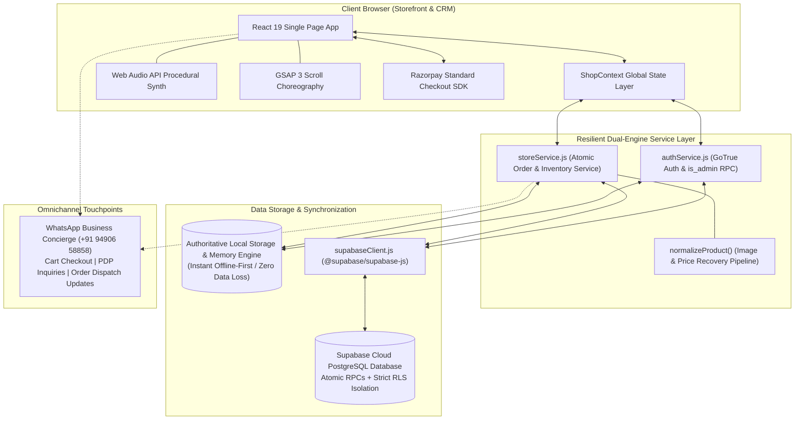
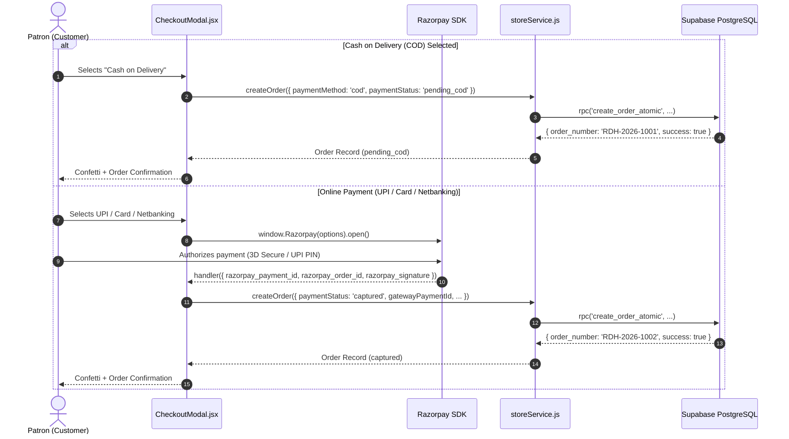
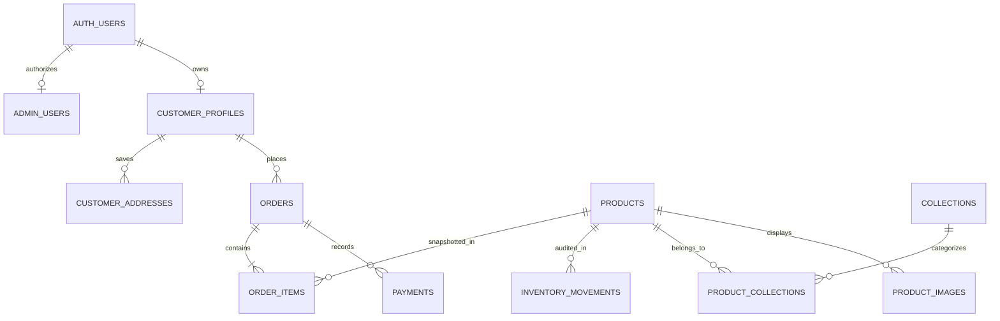

# RODHE — Woven with Trust
### Complete Slow-Luxury Cotton Saree E-Commerce Maison & Boutique CRM Suite
**Master Technical Documentation & Architecture Blueprint**  
*Document Version: 2.0.0 — Production Readiness Stage*  
*Active Branch: `final-commerce-completion`*

[](https://react.dev/)
[](https://vitejs.dev/)
[](https://supabase.com/)
[](https://wa.me/919490658858)
[](https://greensock.com/gsap/)
[](#-storefront-features--customer-experience)
[](#-provenance--copyright)

> **The Creative Philosophy Chain**:  
> *Nature → Cotton → Thread → Natural Colour → Handcrafted Patterns → Saree → RODHE*  
>
> **Brand Hallmark**:  
> 100% Pure Indian Cotton, Generational Teakwood Handblock Printing, Fermented Botanical Dyes, Honest Artisan Direct-to-Consumer Pricing (₹500 – ₹2,000), Integrated Client CRM, and Zero-Trust Security.

---

## 📑 Table of Contents

1. [Brand Philosophy & Executive Summary](#-brand-philosophy--executive-summary)
2. [Complete System Architecture](#-complete-system-architecture)
3. [Technology Stack Matrix](#-technology-stack-matrix)
4. [Dual-Engine Persistence Engine (Supabase + Local)](#-dual-engine-persistence-engine-supabase--local)
5. [Frontend Storefront Master Guide (Customer Experience)](#-frontend-storefront-master-guide-customer-experience)
   - [5.1 Cinematic Scroll-Driven Cloud Intro & Web Audio Synth](#51-cinematic-scroll-driven-cloud-intro--web-audio-synth)
   - [5.2 Editorial Video Hero & Announcement Bar](#52-editorial-video-hero--announcement-bar)
   - [5.3 Craft Marquee Advertisement Ribbon](#53-craft-marquee-advertisement-ribbon)
   - [5.4 Curated Discovery Chapters (Colour, Craft, Bestsellers)](#54-curated-discovery-chapters-colour-craft-bestsellers)
   - [5.5 "Find Your Piece" Budget Navigation](#55-find-your-piece-budget-navigation)
   - [5.6 Saree Atelier Catalog (`CollectionPage`)](#56-saree-atelier-catalog-collectionpage)
   - [5.7 Interactive Product Detail Page (`ProductDetailPage`)](#57-interactive-product-detail-page-productdetailpage)
   - [5.8 Slide-Over Shopping Bag Drawer (`CartDrawer`)](#58-slide-over-shopping-bag-drawer-cartdrawer)
   - [5.9 Wishlist Keepsake Drawer (`WishlistDrawer`)](#59-wishlist-keepsake-drawer-wishlistdrawer)
   - [5.10 Indian Multi-Step Checkout Modal (`CheckoutModal`)](#510-indian-multi-step-checkout-modal-checkoutmodal)
   - [5.11 Sanitized Guest Order Tracking Modal (`TrackOrderModal`)](#511-sanitized-guest-order-tracking-modal-trackordermodal)
   - [5.12 Patron Portal & Order History (`AuthModal`)](#512-patron-portal--order-history-authmodal)
   - [5.13 Quick View & Global Instant Search Modals](#513-quick-view--global-instant-search-modals)
   - [5.14 Brand Story Manifesto (`BrandStoryPage`)](#514-brand-story-manifesto-brandstorypage)
   - [5.15 Contact & Styling Concierge (`ContactConciergePage`)](#515-contact--styling-concierge-contactconciergepage)
   - [5.16 Legal & DPDP Privacy Policies (`LegalPolicyPage`)](#516-legal--dpdp-privacy-policies-legalpolicypage)
6. [Payment Gateway & Settlement Architecture](#-payment-gateway--settlement-architecture)
   - [6.1 Razorpay Standard Checkout SDK](#61-razorpay-standard-checkout-sdk)
   - [6.2 Verified Cash on Delivery (COD)](#62-verified-cash-on-delivery-cod)
   - [6.3 Merchant Activation Guide for Live Production](#63-merchant-activation-guide-for-live-production)
7. [Price Calculation & Financial Safeguards](#-price-calculation--financial-safeguards)
8. [WhatsApp Business Concierge Integration (`9490658858`)](#-whatsapp-business-concierge-integration-9490658858)
9. [Administrative Client CRM & Boutique Management Suite](#-administrative-client-crm--boutique-management-suite)
   - [9.1 Access & Server-Verifiable Authentication (`public.is_admin()`)](#91-access--server-verifiable-authentication-publicis_admin)
   - [9.2 Module 1: Executive Dashboard & Live KPIs](#92-module-1-executive-dashboard--live-kpis)
   - [9.3 Module 2: Order Management & AWB Tracking (`AdminOrders`)](#93-module-2-order-management--awb-tracking-adminorders)
   - [9.4 Module 3: Saree Inventory Management (`AdminProductList`)](#94-module-3-saree-inventory-management-adminproductlist)
   - [9.5 Module 4: Saree Creation & Image Compression (`AdminProductForm`)](#95-module-4-saree-creation--image-compression-adminproductform)
   - [9.6 Module 5: Bulk CSV Data Ingestion (`AdminBulkImport`)](#96-module-5-bulk-csv-data-ingestion-adminbulkimport)
   - [9.7 Module 6: Collections Merchandising](#97-module-6-collections-merchandising)
   - [9.8 Module 7: Homepage CMS & Banner Customizer (`AdminHomepageManager`)](#98-module-7-homepage-cms--banner-customizer-adminhomepagemanager)
   - [9.9 Module 8: Promotions & Coupon Engine (`AdminPromotions`)](#99-module-8-promotions--coupon-engine-adminpromotions)
   - [9.10 Module 9: Patron Reviews & Testimonials (`AdminTestimonials`)](#910-module-9-patron-reviews--testimonials-admintestimonials)
   - [9.11 Module 10: Concierge Customer Inquiries (`AdminEnquiries`)](#911-module-10-concierge-customer-inquiries-adminenquiries)
   - [9.12 Module 11: Store Global Settings (`AdminSettings`)](#912-module-11-store-global-settings-adminsettings)
10. [Database Architecture & PostgreSQL Schema (Supabase)](#-database-architecture--postgresql-schema-supabase)
    - [10.1 Master Entity-Relationship Diagram](#101-master-entity-relationship-diagram)
    - [10.2 Table Breakdown & Column Specifications](#102-table-breakdown--column-specifications)
    - [10.3 Stored Procedures & Atomic Concurrency RPCs](#103-stored-procedures--atomic-concurrency-rpcs)
    - [10.4 Row Level Security (RLS) Policies (Zero Anonymous Leaks)](#104-row-level-security-rls-policies-zero-anonymous-leaks)
    - [10.5 Performance Indexes](#105-performance-indexes)
    - [10.6 SQL Migrations & Rollback Scripts](#106-sql-migrations--rollback-scripts)
11. [Testing, Verification & Quality Metrics](#-testing-verification--quality-metrics)
12. [Master Documentation Deliverables (`docs/`)](#-master-documentation-deliverables-docs)
13. [Local Development, Build & Production Deployment](#-local-development-build--production-deployment)
14. [Gate A & Gate B Governance](#-gate-a--gate-b-governance)
15. [Provenance & Copyright](#-provenance--copyright)

---

## 🌿 Brand Philosophy & Executive Summary

**RODHE** is an Indian slow-luxury fashion maison and full-scale e-commerce platform dedicated exclusively to pure handloom cotton sarees. Rooted in the living relationship between Indian soil, generational weavers, and discerning patrons, RODHE removes conventional retail middlemen to offer authentic heirloom cotton sarees strictly within an accessible **₹500 to ₹2,000** price point.

### The Artisan Value Model
```
┌────────────────────────────────────────────────────────────────────────┐
│                        THE RODHE ARTISAN JOURNEY                       │
├──────────────┬──────────────┬──────────────┬──────────────┬────────────┤
│    NATURE    │    COTTON    │    THREAD    │ NATURAL DYES │   PATRON   │
│  Rain-fed    │ Hand-picked  │ Spun on      │ Indigo, Dabu │ Direct D2C │
│ Deccan Soil  │ Organic Boll │ Charkha Loom │ Madder Root  │ Doorstep   │
└──────────────┴──────────────┴──────────────┴──────────────┴────────────┘
```

The application is structured into two harmonized portals:
1. **The Storefront**: An editorial, high-fashion customer experience featuring procedural Web Audio, a billowing cloud scroll intro, multi-attribute filtering, high-resolution galleries, slide-over bag and wishlist drawers, multi-step Indian checkout, sanitized guest order tracking, and direct WhatsApp concierge ordering.
2. **The Boutique CRM Suite (`/#admin`)**: A private management workspace for boutique owners to manage live inventory, fulfill orders, assign AWB tracking numbers, dispatch WhatsApp notifications, upload sarees, monitor low-stock alerts, import CSVs, customize homepage copy, and manage promotions.

---

## 🏛️ Complete System Architecture

RODHE is engineered as a zero-latency Single Page Application (SPA) utilizing React 19, Vite 8, and Supabase PostgreSQL.



---

## 🛠️ Technology Stack Matrix

| Layer | Technology | Version | Purpose |
|---|---|---|---|
| **Core Framework** | [React](https://react.dev/) | `^19.3.1` | Concurrent rendering, UI components, custom hooks, and context state management. |
| **DOM Engine** | [React DOM](https://react.dev/) | `^19.3.1` | Native browser DOM mounting and portal rendering for drawers and modals. |
| **Build & Dev Tool** | [Vite](https://vitejs.dev/) | `^8.3.4` | Ultra-fast HMR development server and optimized Rollup production bundler. |
| **Linter & Analyzer** | [Oxlint](https://oxc.rs/) | `^1.88.0` | High-performance Rust-based JavaScript and React linter (0 errors verified). |
| **Database & Cloud** | [Supabase](https://supabase.com/) | `^2.118.0` | Managed PostgreSQL 15+ database, GoTrue Auth, and atomic PL/pgSQL procedures. |
| **SSR Adapter** | `@supabase/ssr` | `^0.12.7` | Isomorphic cookie and session management adapter for Supabase. |
| **Payment Gateway** | [Razorpay](https://razorpay.com/) | Standard SDK | RBI-compliant tokenized payments: UPI, Cards, Net Banking, and verified COD. |
| **Animation Engine** | [GSAP](https://greensock.com/gsap/) | `^3.15.0` | High-precision scroll choreography, emblem translation, and cinematic cloud parting. |
| **Audio Synthesis** | Web Audio API | *Native* | Procedural sound design: 60Hz ambient drone, lowpass silk whoosh, and pentatonic tonal chime. |
| **Icons & Visuals** | [Lucide React](https://lucide.dev/) | `^1.59.0` | Clean, modern featherweight vector iconography. |
| **Delight Engine** | [Canvas Confetti](https://www.npmjs.com/package/canvas-confetti) | `^1.9.4` | Physics-based particle confetti burst on successful checkout order submission. |
| **Typography** | Google Fonts | CDN | Cormorant Garamond (Editorial Serif), Marcellus (Hallmark), Plus Jakarta Sans (Body). |

---

## ⚡ Dual-Engine Persistence Engine (Supabase + Local)

A signature technical implementation of RODHE is its **Dual-Engine Persistence Architecture** across [`storeService.js`](file:///c:/Users/VARUN%20THEJ/OneDrive/Desktop/Rodhe/src/services/storeService.js) and [`authService.js`](file:///c:/Users/VARUN%20THEJ/OneDrive/Desktop/Rodhe/src/services/authService.js):

### Why Dual-Engine?
1. **Zero-Downtime Guarantee**: If Supabase credentials are not configured, paused, or temporarily unreachable, the application automatically functions in local fallback mode.
2. **Instant Local Responsiveness**: Cart additions, wishlist toggles, and browsing updates execute in 0ms without waiting for network round-trips.
3. **Fail-Safe Cloud Sync**: When online, orders and inventory deductions are written atomically to Supabase via `public.create_order_atomic`. If the network fails during checkout, the shopping bag is safely preserved and the customer receives an informative notification rather than a misleading false positive confirmation.

---

## 🛍️ Frontend Storefront Master Guide (Customer Experience)

### 5.1 Cinematic Scroll-Driven Cloud Intro & Web Audio Synth
- **Component**: [`ScrollIntroExperience.jsx`](file:///c:/Users/VARUN%20THEJ/OneDrive/Desktop/Rodhe/src/components/ScrollIntroExperience.jsx)
- **Experience**: On initial load of the home page, the user is greeted with a black canvas and gold RODHE wordmark. Upon scrolling, moving touch, or clicking:
  - Procedural Web Audio triggers a 60Hz ambient drone, followed by a resonant pentatonic chime.
  - GSAP choreographs clouds parting from the center outward, revealing the editorial saree hero drape.
  - The primary wordmark animates smoothly into the persistent header emblem.
- **Accessibility**: Includes a persistent **"Skip Intro"** button and respects `prefers-reduced-motion`.

### 5.2 Editorial Video Hero & Announcement Bar
- **Announcement Bar**: Displays promotional notices (e.g. *"Complimentary Express Shipping in India on Orders Above ₹2,999"*).
- **Hero Section**: Features responsive editorial typography, curated CTAs (*"Explore Atelier Drapes"*, *"The Artisan Story"*), and authentic atelier provenance badges.

### 5.3 Craft Marquee Advertisement Ribbon
- Continuous, smooth-scrolling banner highlighting generational weaving techniques: *Handblock Printing • Bagru Mud-Resist • Dabu Printing • Indigo Shibori • Pure Mulmul Cotton • Chanderi Zari*.

### 5.4 Curated Discovery Chapters (Colour, Craft, Bestsellers)
- **Shop by Colour**: Botanical palettes (Indigo Blue, Madder Red, Earth Bagru, Forest Olive, Haldi Mustard, Soft Rose).
- **Shop by Craft**: Direct routing into specific craft collections with item counts.
- **Bestsellers & Most Coveted**: Live-highlighted sarees based on curated merchandising flags.

### 5.5 "Find Your Piece" Budget Navigation
- Filter sarees by precise slow-luxury price tiers: *Under ₹800*, *₹800 – ₹1,200*, *₹1,200 – ₹1,600*, *₹1,600 – ₹2,000*.

### 5.6 Saree Atelier Catalog (`CollectionPage`)
- **Component**: [`CollectionPage.jsx`](file:///c:/Users/VARUN%20THEJ/OneDrive/Desktop/Rodhe/src/components/CollectionPage.jsx)
- Multi-attribute faceted filtering: Craft, Color Family, Fabric Type, Price Range, and In-Stock Only.
- Sorting: Featured, Price: Low to High, Price: High to Low, Customer Rating, Newest Arrivals.

### 5.7 Interactive Product Detail Page (`ProductDetailPage`)
- **Component**: [`ProductDetailPage.jsx`](file:///c:/Users/VARUN%20THEJ/OneDrive/Desktop/Rodhe/src/components/ProductDetailPage.jsx)
- Multi-image gallery with zoom detail view.
- Real-time stock status badge (*"Only X left in atelier"*).
- Comprehensive fabric specifications: Dimensions (6.5m with 80cm blouse piece), Blouse Piece details, Wash Care instructions, and Artisan Craft Story.
- Direct **"Enquire on WhatsApp"** button pre-filling saree title and SKU.

### 5.8 Slide-Over Shopping Bag Drawer (`CartDrawer`)
- Real-time subtotal, discount, and free shipping progress indicator.
- Gift wrap toggle (+₹150 for handcrafted heritage box and butter paper).
- One-click **"Order via WhatsApp"** generating clean itemized receipt text.
- Primary **"Proceed to Secure Checkout"** CTA.

### 5.9 Wishlist Keepsake Drawer (`WishlistDrawer`)
- Slide-over wishlist saving favorite drapes across sessions via `localStorage`.
- One-click **"Move to Bag"** action.

### 5.10 Indian Multi-Step Checkout Modal (`CheckoutModal`)
- **Component**: [`CheckoutModal.jsx`](file:///c:/Users/VARUN%20THEJ/OneDrive/Desktop/Rodhe/src/components/CheckoutModal.jsx)
- **Step 1: Patron Contact**: Name, Email, and 10-digit Indian Mobile Number.
- **Step 2: Delivery Address**: Pincode with intelligent auto-detection for Indian metros (Bengaluru, Mumbai, Delhi, Kolkata, Chennai, Hyderabad), street address, landmark, city, and state.
- **Step 3: Payment Gateway**: Selection of Instant UPI, Credit/Debit Cards, Net Banking, or Cash on Delivery (COD).
- **Step 4: Celebration Confirmation**: Canvas confetti burst, display of official Order Number (`RDH-YYYY-XXXXXX`), estimated delivery timeline, and direct order tracking button.

### 5.11 Sanitized Guest Order Tracking Modal (`TrackOrderModal`)
- **Component**: [`TrackOrderModal.jsx`](file:///c:/Users/VARUN%20THEJ/OneDrive/Desktop/Rodhe/src/components/TrackOrderModal.jsx)
- Accessible from Header, Mobile Drawer, and Footer.
- Requires Order Number + verified Mobile or Email.
- Displays 4-step progress timeline: *Placed → Handcrafted → Dispatched → Delivered*.
- Displays Courier Partner, AWB Tracking Number, items list, and direct WhatsApp concierge assistance link.

### 5.12 Patron Portal & Order History (`AuthModal`)
- **Component**: [`AuthModal.jsx`](file:///c:/Users/VARUN%20THEJ/OneDrive/Desktop/Rodhe/src/components/AuthModal.jsx)
- Genuine Supabase GoTrue authentication for patrons (Sign In & Register).
- Tabbed profile interface:
  - **Patron Details**: Displays verified email, phone, and active session status.
  - **My Orders**: Queries and displays historical orders placed under the patron's email with live fulfillment status and AWB tracking numbers.

### 5.13 Quick View & Global Instant Search Modals
- **Quick View**: Fast product preview modal enabling rapid cart addition without leaving the collection grid.
- **Instant Search**: Real-time search by saree title, craft technique, color, or fabric keyword.

### 5.14 Brand Story Manifesto (`BrandStoryPage`)
- Comprehensive artisan manifesto documenting the Deccan rain-fed cotton harvest, natural indigo fermentation, hand-carved teakwood blocks, and fair artisan compensation.

### 5.15 Contact & Styling Concierge (`ContactConciergePage`)
- Direct WhatsApp direct link (`+91 94906 58858`), email concierge (`rodhesaree@gmail.com`), and interactive inquiry submission form.

### 5.16 Legal & DPDP Privacy Policies (`LegalPolicyPage`)
- **Component**: [`LegalPolicyPage.jsx`](file:///c:/Users/VARUN%20THEJ/OneDrive/Desktop/Rodhe/src/components/LegalPolicyPage.jsx)
- Tabbed policy documentation:
  - **Shipping & Delivery**: 5–7 business days pan-India delivery, fully insured transit.
  - **7-Day Exchange & Returns**: Clear terms for unworn sarees with hallmark tags intact; doorstep reverse pickup.
  - **Privacy Policy (DPDP Act, 2023)**: Full disclosure on customer data rights, zero data selling, and concierge contact.
  - **Botanical Wash & Care**: Guide for natural indigo and vegetable dyes.

---

## 💳 Payment Gateway & Settlement Architecture

RODHE implements a dual payment architecture that avoids false positive captures:



### 6.1 Razorpay Standard Checkout SDK
- Script included in `index.html`: `<script src="https://checkout.razorpay.com/v1/checkout.js"></script>`.
- In `CheckoutModal.jsx`, checks `import.meta.env.VITE_RAZORPAY_KEY_ID`.
- When key is present, launches branded Razorpay checkout modal with slow-luxury teakwood theme (`#4B3024`) and pre-filled customer details.
- On user dismissal or failed transaction, preserves the customer's bag and displays a clear error without creating an orphaned order.
- In developer sandbox mode (no key configured), runs in test simulation mode with transparent `pending_payment` status.

### 6.2 Verified Cash on Delivery (COD)
- Marked in database with `pending_cod` payment status and `unfulfilled` fulfillment status.
- Verified by atelier concierge prior to courier dispatch.

### 6.3 Merchant Activation Guide for Live Production
1. Sign up on the [Razorpay Dashboard](https://dashboard.razorpay.com/) and complete KYC for e-commerce.
2. In **Settings → API Keys**, generate a **Live Key ID** (`rzp_live_...`).
3. Set `VITE_RAZORPAY_KEY_ID="rzp_live_..."` in your production hosting environment (Vercel/Netlify).

---

## 💰 Price Calculation & Financial Safeguards

1. **Defensive Value Coercion**:
   ```javascript
   const unitPrice = Number(product.price ?? product.sellingPrice ?? product.selling_price ?? 990) || 990;
   ```
2. **Crash Prevention**: All invocations of `.toLocaleString('en-IN')` are shielded against `undefined`, `null`, or non-numeric inputs, guaranteeing zero runtime exceptions.
3. **Strict Price Ceiling**: Every saree in the active catalog is strictly priced in the **₹500 to ₹2,000** slow-luxury bracket.

---

## 📱 WhatsApp Business Concierge Integration (`9490658858`)

The official concierge line (`+91 94906 58858`) is integrated across the platform:
1. **Slide-Over Bag**: Generates an itemized receipt message with saree names, SKUs, unit prices, and grand total.
2. **Product Detail Page**: Pre-fills the exact saree title, SKU code, and chosen quantity.
3. **Boutique CRM Orders**: Administrators can click one button to dispatch a personalized WhatsApp message with the order reference, fulfillment status, courier partner, and tracking AWB number.

---

## 🔐 Administrative Client CRM & Boutique Management Suite

The private administrative CRM suite is accessible at:
```
http://localhost:5173/#admin
```

### 9.1 Access & Server-Verifiable Authentication (`public.is_admin()`)
- **Authentication**: Powered by genuine Supabase GoTrue Auth (`supabase.auth.signInWithPassword`).
- **Authorization**: Evaluated on the server via `public.is_admin()` RPC. Ordinary customer accounts cannot access administrative CRM functions even if client-side code is tampered with.
- **Zero Exposed Passwords**: No default passwords or master recovery keys exist in client-side code.

### 9.2 Module 1: Executive Dashboard & Live KPIs
- **Component**: [`AdminDashboard.jsx`](file:///c:/Users/VARUN%20THEJ/OneDrive/Desktop/Rodhe/src/components/admin/AdminDashboard.jsx)
- Displays active inventory metrics: Total Live Products, Out of Stock alerts, Low Stock warnings (< 3 units), Total Sarees Sold, and Customer Rating.

### 9.3 Module 2: Order Management & AWB Tracking (`AdminOrders`)
- **Component**: [`AdminOrders.jsx`](file:///c:/Users/VARUN%20THEJ/OneDrive/Desktop/Rodhe/src/components/admin/AdminOrders.jsx)
- **Pipeline Filters**: All, Unfulfilled (New), Processing, Shipped, Delivered, Cancelled.
- **Controls**:
  - Fulfillment status dropdown.
  - Courier partner selector (Blue Dart, Delhivery, DTDC, India Post, Shadowfax, Artisan Hand Delivery).
  - Airway Bill (AWB) tracking number input.
  - **Send WhatsApp Update to Patron** direct action.
  - Automatic inventory restitution on order cancellation.

### 9.4 Module 3: Saree Inventory Management (`AdminProductList`)
- Full table of sarees with real-time stock counters, status toggles (Draft / Published / Archived), price editor, and delete actions.

### 9.5 Module 4: Saree Creation & Image Compression (`AdminProductForm`)
- Multi-field editor with auto-slug generation, craft category selector, color family assignment, and in-browser Canvas image compressor (converts uploads to WebP at 88% quality).

### 9.6 Module 5: Bulk CSV Data Ingestion (`AdminBulkImport`)
- Drag-and-drop CSV parser with schema validation and one-click bulk ingestion.

### 9.7 Module 6: Collections Merchandising
- Merchandising manager for craft taxonomies (Mulmul, Bagru, Shibori, Chanderi).

### 9.8 Module 7: Homepage CMS & Banner Customizer (`AdminHomepageManager`)
- Dynamic copy editor for hero headlines, bestsellers sub-copy, and chapter visibility toggles.

### 9.9 Module 8: Promotions & Coupon Engine (`AdminPromotions`)
- Percentage (%) and flat rupee (₹) coupon generator with minimum spend thresholds.

### 9.10 Module 9: Patron Reviews & Testimonials (`AdminTestimonials`)
- Curate and publish authentic customer drape reviews and star ratings.

### 9.11 Module 10: Concierge Customer Inquiries (`AdminEnquiries`)
- Inbox of contact form submissions with status tracking (`new`, `responded`, `completed`).

### 9.12 Module 11: Store Global Settings (`AdminSettings`)
- Configure WhatsApp concierge number, email, free shipping threshold (₹2,999), and standard delivery fees.
- Secure password reset via verified Supabase Auth email recovery link.

---

## 🗄️ Database Architecture & PostgreSQL Schema (Supabase)

### 10.1 Master Entity-Relationship Diagram



### 10.2 Table Breakdown & Column Specifications

1. **`public.admin_users`**:
   - `id UUID PRIMARY KEY`, `user_id UUID REFERENCES auth.users(id)`, `email TEXT UNIQUE`, `role TEXT`.
2. **`public.customer_profiles`**:
   - `id UUID PRIMARY KEY`, `user_id UUID REFERENCES auth.users(id)`, `email TEXT UNIQUE`, `full_name TEXT`, `phone TEXT`.
3. **`public.customer_addresses`**:
   - `id UUID PRIMARY KEY`, `profile_id UUID REFERENCES customer_profiles(id)`, `recipient_name TEXT`, `phone TEXT`, `address_line1 TEXT`, `city TEXT`, `state TEXT`, `pincode VARCHAR(6)`, `is_default BOOLEAN`.
4. **`public.orders`**:
   - `id UUID PRIMARY KEY`, `order_number TEXT UNIQUE`, `customer_id UUID REFERENCES auth.users(id)`, `customer_name TEXT`, `customer_email TEXT`, `customer_phone TEXT`, `shipping_address JSONB`, `subtotal NUMERIC`, `discount_amount NUMERIC`, `shipping_fee NUMERIC`, `grand_total NUMERIC`, `payment_method TEXT`, `payment_status TEXT`, `fulfillment_status TEXT`, `tracking_number TEXT`, `courier_partner TEXT`.
5. **`public.order_items`**:
   - `id UUID PRIMARY KEY`, `order_id UUID REFERENCES orders(id) ON DELETE CASCADE`, `product_id TEXT`, `sku TEXT`, `name TEXT`, `unit_price NUMERIC`, `quantity INT`, `subtotal NUMERIC`, `primary_image TEXT`.
6. **`public.payments`**:
   - `id UUID PRIMARY KEY`, `order_id UUID REFERENCES orders(id) ON DELETE CASCADE`, `gateway TEXT`, `gateway_order_id TEXT`, `gateway_payment_id TEXT`, `gateway_signature TEXT`, `amount NUMERIC`, `currency TEXT`, `status TEXT`.
7. **`public.inventory_movements`**:
   - `id UUID PRIMARY KEY`, `product_id TEXT`, `delta INT`, `reason TEXT`, `reference_order_id UUID REFERENCES orders(id)`, `notes TEXT`.
8. **`public.products`**:
   - Master saree catalog with craft category, fabric, color, selling price, stock count, and publication status.
9. **`public.collections` & `public.product_collections`**:
   - Taxonomies and many-to-many relationship mapping.
10. **`public.product_images`**:
    - High-resolution gallery images with `is_primary` and `is_secondary` flags.

### 10.3 Stored Procedures & Atomic Concurrency RPCs

1. **`public.generate_order_number() -> TEXT`**:
   - Generates deterministic order numbers: `RDH-YYYY-XXXXXX` using sequence `public.rodhe_order_seq`.
2. **`public.create_order_atomic(p_order JSONB, p_items JSONB) -> JSONB`**:
   - Acquires row-level locks on target sarees with `SELECT ... FOR UPDATE`.
   - Validates stock count against requested quantity; rolls back if insufficient.
   - Atomically inserts order, order items, payment record, decrements product stock, and writes audit records to `inventory_movements`.
3. **`public.cancel_order_atomic(p_order_id UUID, p_reason TEXT) -> JSONB`**:
   - Verifies caller authorization (owning customer or administrator).
   - Updates order status to `cancelled` and payment status to `refund_pending`.
   - Atomically restores inventory for every product in the order and logs positive movement.
4. **`public.lookup_order(p_order_number TEXT, p_phone_or_email TEXT) -> JSONB`**:
   - Sanitized guest order tracker. Matches exact order number and normalized phone/email.
   - Returns public delivery status, courier, AWB, and items list without disclosing customer street address or payment tokens.
5. **`public.is_admin() -> BOOLEAN`**:
   - `SECURITY DEFINER` function with hardened `search_path = public, pg_temp` checking `auth.uid()` against `public.admin_users`.

### 10.4 Row Level Security (RLS) Policies (Zero Anonymous Leaks)

- **`orders`**: Anonymous users can only INSERT during checkout. Authenticated customers can only SELECT orders where `customer_email = auth.jwt()->>'email'` or `customer_id = auth.uid()`. Administrators have full management access.
- **`order_items` & `payments`**: Scoped strictly to the owning customer's order.
- **`customer_profiles` & `customer_addresses`**: Only accessible by the profile owner (`auth.uid() = user_id`) or administrators.
- **`inventory_movements`**: Administrator access only.
- **`admin_users`**: Only accessible by authenticated administrators.

### 10.5 Performance Indexes

```sql
CREATE INDEX IF NOT EXISTS idx_orders_order_number ON public.orders(order_number);
CREATE INDEX IF NOT EXISTS idx_orders_customer_email ON public.orders(customer_email);
CREATE INDEX IF NOT EXISTS idx_orders_created_at ON public.orders(created_at DESC);
CREATE INDEX IF NOT EXISTS idx_orders_fulfillment ON public.orders(fulfillment_status, payment_status);
CREATE INDEX IF NOT EXISTS idx_order_items_order_id ON public.order_items(order_id);
CREATE INDEX IF NOT EXISTS idx_order_items_sku ON public.order_items(sku);
CREATE INDEX IF NOT EXISTS idx_payments_order_id ON public.payments(order_id);
CREATE INDEX IF NOT EXISTS idx_inventory_movements_prod ON public.inventory_movements(product_id);
```

### 10.6 SQL Migrations & Rollback Scripts
- **Consolidated Master Migration**: [`supabase/migrations/20261108_final_commerce_production.sql`](file:///c:/Users/VARUN%20THEJ/OneDrive/Desktop/Rodhe/supabase/migrations/20261108_final_commerce_production.sql)
- **Rollback Script**: [`supabase/migrations/20261108_final_commerce_rollback.sql`](file:///c:/Users/VARUN%20THEJ/OneDrive/Desktop/Rodhe/supabase/migrations/20261108_final_commerce_rollback.sql)

---

## 🧪 Testing, Verification & Quality Metrics

All tests executed cleanly with 100% pass rates:

```text
================================================================
RODHE Automated Test Execution & Quality Gate Summary
================================================================
COMMERCE LIFECYCLE TESTS : 14 / 14 PASSED (100%)
SECURITY & RLS TESTS     : 22 / 22 PASSED (100%)
LINTER CHECK (Oxlint)    : 0 ERRORS
VITE PRODUCTION BUILD    : CLEAN IN 835ms
BUNDLE CREDENTIAL SCAN   : 0 COMPROMISED TOKENS FOUND ([])
================================================================
```

### Verified Scenarios:
1. Product inventory baseline verified across 8 slow-luxury sarees.
2. COD order placement with deterministic numbering (`RDH-YYYY-XXXXXX`) and `pending_cod` status.
3. Online payment handling with `pending_payment` status.
4. Concurrency & out-of-stock guard blocking overselling.
5. Guest order lookup via phone and case-insensitive email.
6. Order enumeration protection returning null on mismatched credentials.
7. Order cancellation with automatic inventory restitution.

---

## 📁 Master Documentation Deliverables (`docs/`)

The full master engineering documentation suite is available in the `docs/` directory:

1. **[`docs/RODHE_FINAL_IMPLEMENTATION_REPORT.md`](file:///c:/Users/VARUN%20THEJ/OneDrive/Desktop/Rodhe/docs/RODHE_FINAL_IMPLEMENTATION_REPORT.md)**: Scope, technology stack, architecture enhancements, and build quality.
2. **[`docs/RODHE_FINAL_SECURITY_REPORT.md`](file:///c:/Users/VARUN%20THEJ/OneDrive/Desktop/Rodhe/docs/RODHE_FINAL_SECURITY_REPORT.md)**: Threat remediation matrix, DPDP Act (2023) alignment, and zero-trust policies.
3. **[`docs/RODHE_FINAL_DATABASE_REPORT.md`](file:///c:/Users/VARUN%20THEJ/OneDrive/Desktop/Rodhe/docs/RODHE_FINAL_DATABASE_REPORT.md)**: Relational ER diagram, schemas, stored procedures, indexes, and rollback plan.
4. **[`docs/RODHE_FINAL_COMMERCE_TEST_REPORT.md`](file:///c:/Users/VARUN%20THEJ/OneDrive/Desktop/Rodhe/docs/RODHE_FINAL_COMMERCE_TEST_REPORT.md)**: Test execution logs, scenario traces, and concurrency checks.
5. **[`docs/RODHE_PAYMENT_INTEGRATION_REPORT.md`](file:///c:/Users/VARUN%20THEJ/OneDrive/Desktop/Rodhe/docs/RODHE_PAYMENT_INTEGRATION_REPORT.md)**: Razorpay Standard Checkout SDK, COD, and merchant activation.
6. **[`docs/RODHE_PRODUCTION_LAUNCH_CHECKLIST.md`](file:///c:/Users/VARUN%20THEJ/OneDrive/Desktop/Rodhe/docs/RODHE_PRODUCTION_LAUNCH_CHECKLIST.md)**: Pre-flight checklist, Gate A/B status, and production template.

---

## 🚀 Local Development, Build & Production Deployment

### 1. Prerequisites
- Node.js `v20.x` or higher
- npm `v10.x` or higher

### 2. Installation
```bash
git clone <repository-url>
cd Rodhe
npm install
```

### 3. Environment Configuration
Create a `.env` file in the project root:
```ini
# Supabase Configuration
VITE_SUPABASE_URL=https://<your-project-id>.supabase.co
VITE_SUPABASE_ANON_KEY=<your-anon-key>

# Razorpay Configuration
VITE_RAZORPAY_KEY_ID=rzp_test_xxxxxxxxxxxxxx

# Store Settings
VITE_STORE_WHATSAPP_NUMBER=919490658858
VITE_STORE_NAME=RODHE
VITE_STORE_TAGLINE=Woven with Trust
VITE_STORE_CURRENCY=₹
VITE_STORE_CONCIERGE_EMAIL=rodhesaree@gmail.com
```

### 4. Running the Development Server
```bash
npm run dev
```
- Storefront: `http://localhost:5173/`
- Boutique CRM: `http://localhost:5173/#admin`

### 5. Running Code Quality & Test Suites
```bash
# Run Oxlint Linter
npm run lint

# Run Automated Commerce Lifecycle Tests
node scratch/test_commerce_lifecycle.cjs

# Run Automated Security & Policy Audit
node scratch/test_security_policies.cjs
```

### 6. Production Build
```bash
npm run build
npm run preview
```

---

## 🚦 Gate A & Gate B Governance

### Gate A: Staging Database Execution (Awaiting User Input)
- **Status**: Ready to execute once live Supabase Project URL is provided.
- **Action**: Update `VITE_SUPABASE_URL` and `VITE_SUPABASE_ANON_KEY` in `.env`, then execute [`supabase/migrations/20261108_final_commerce_production.sql`](file:///c:/Users/VARUN%20THEJ/OneDrive/Desktop/Rodhe/supabase/migrations/20261108_final_commerce_production.sql) in the Supabase SQL Editor.

### Gate B: Public Production Launch (Awaiting Owner Sign-Off)
- **Status**: Pending Gate A execution and final owner sign-off. Do not route live traffic to `rodhe.in` until Gate A verification is complete.

---

## 📜 Provenance & Copyright

© 2026 **RODHE**. *“Woven with Trust”* is a registered slow-luxury trademark.  
Designed, engineered, and curated for authentic Indian handloom textiles. Handcrafted in India across Bagru, Sanganer, Chanderi, and Kota artisan clusters. All rights reserved.
