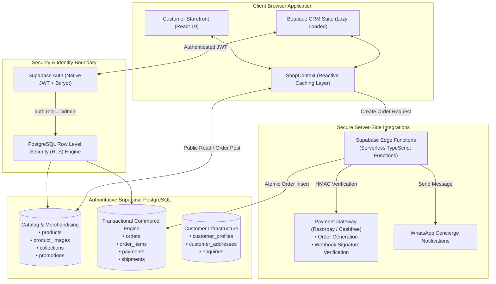

# 09. ARCHITECTURE RECOMMENDATIONS — RODHE
## Target Systems Architecture, Security & Commerce Engine

---

## 1. Architectural Philosophy

The objective is to transform RODHE from an editorial prototype into a secure, consistent, production-grade e-commerce maison.

---

## 2. Core Architectural Pillars

### 2.1 Principle 1: PostgreSQL is the Sole Authoritative Source of Truth
- Eliminate the competing `localStorage` database paradigm.
- `localStorage` must strictly serve as a temporary browser cache for cart items and offline resilience, marked with explicit `pending_sync` states.
- All product inventory, pricing, catalog updates, and order placements must commit authoritatively to PostgreSQL.

### 2.2 Principle 2: Native Supabase Auth
- Deprecate `public.admin_users` table and plaintext passwords.
- Provision administrators through Supabase Auth (`auth.users`).
- Use cryptographically signed JWT sessions with automatic refresh.
- Enforce RLS policies using `auth.role() = 'authenticated'` and `auth.jwt() -> 'app_metadata' ->> 'role' = 'admin'`.

### 2.3 Principle 3: Trusted Server-Side Order & Payment Processing
- Frontend prices and discount calculations must **never be trusted** as authoritative payment amounts.
- When a customer clicks "Place Order", a lightweight Supabase Edge Function:
  1. Validates that every saree in the cart is in stock.
  2. Recalculates line items and totals against database pricing.
  3. Verifies coupon validity in `public.promotions`.
  4. Generates an official payment order via Payment Gateway API (e.g. Razorpay).
  5. Returns the signed payment token to the frontend checkout modal.
  6. Upon successful payment callback or webhook, atomically deducts stock and marks the order as `captured`.

### 2.4 Principle 4: Code Splitting & Performance Hygiene
- Use `React.lazy()` and `Suspense` for `<AdminPortal />`, reducing the storefront bundle by over 70%.
- Add WebP poster images to the hero video.
- Introduce `robots.txt`, `sitemap.xml`, and dynamic per-product metadata.

