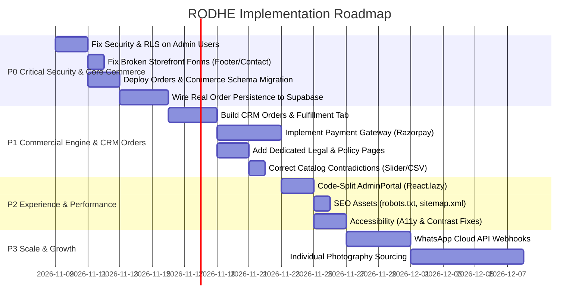

# 10. IMPLEMENTATION ROADMAP — RODHE
## Phased, Dependency-Aware Development & Release Plan

---

## 1. Roadmap Overview & Milestones

---

## 2. Phase P0: Critical Infrastructure, Security & Persistence (Immediate)

### Item P0.1: Secure Administrative Authentication & Revoke Public RLS
- **Current State**: Plaintext passwords stored in `admin_users`. Public read/update/insert policies allow anyone to steal or reset admin credentials.
- **Required Change**:
  1. Revoke public RLS policies on `public.admin_users`.
  2. Implement Supabase Auth (`supabase.auth.signInWithPassword`) with secure JWT session handling.
  3. Remove hardcoded plaintext fallback passwords from `authService.js`.
- **Files Involved**: [`supabase/admin_users_setup.sql`](file:///c:/Users/VARUN%20THEJ/OneDrive/Desktop/Rodhe/supabase/admin_users_setup.sql), [`src/services/authService.js`](file:///c:/Users/VARUN%20THEJ/OneDrive/Desktop/Rodhe/src/services/authService.js), [`src/components/admin/AdminLogin.jsx`](file:///c:/Users/VARUN%20THEJ/OneDrive/Desktop/Rodhe/src/components/admin/AdminLogin.jsx).
- **Risk Level**: **CRITICAL**.
- **Acceptance Criteria**: Unauthorized users cannot query admin passwords; password resets require verified email links.

### Item P0.2: Fix Broken Storefront Methods
- **Current State**:
  - [`ContactConciergePage.jsx`](file:///c:/Users/VARUN%20THEJ/OneDrive/Desktop/Rodhe/src/components/ContactConciergePage.jsx) calls `storeService.createEnquiry` which does not exist (`submitEnquiry` is the real method). Inquiries fail to record.
  - [`Footer.jsx`](file:///c:/Users/VARUN%20THEJ/OneDrive/Desktop/Rodhe/src/components/Footer.jsx) newsletter form does not call `storeService.joinCircle()`. Emails are dropped.
- **Required Change**:
  - Update `ContactConciergePage.jsx` to call `storeService.submitEnquiry()`.
  - Update `Footer.jsx` to call `storeService.joinCircle(newsletterEmail)`.
- **Files Involved**: `src/components/ContactConciergePage.jsx`, `src/components/Footer.jsx`.
- **Risk Level**: Low.
- **Acceptance Criteria**: Inquiries appear in CRM; newsletter subscribers save to `community_signups`.

### Item P0.3: Deploy Commerce Schema Migration (Orders & Items)
- **Current State**: No tables exist to store orders, line items, customer addresses, or payment logs.
- **Required Change**: Execute migration `20261108_commerce_core.sql` in Supabase to create `orders`, `order_items`, `customer_profiles`, `customer_addresses`, `payments`, and `inventory_movements`.
- **Files Involved**: [`supabase/migrations/20261108_commerce_core.sql`](file:///c:/Users/VARUN%20THEJ/OneDrive/Desktop/Rodhe/supabase/migrations/).
- **Risk Level**: Low (additive schema, no breaking changes).
- **Acceptance Criteria**: Tables verified in Supabase PostgreSQL schema with RLS policies enabled.

### Item P0.4: Connect Checkout Modal to Real Database Persistence
- **Current State**: `handlePlaceOrder` uses `setTimeout` and fake ID string.
- **Required Change**: Implement `storeService.createOrder(orderPayload)` that validates items, calculates totals, inserts rows into `public.orders` and `public.order_items`, and returns an authentic database order reference.
- **Files Involved**: [`src/services/storeService.js`](file:///c:/Users/VARUN%20THEJ/OneDrive/Desktop/Rodhe/src/services/storeService.js), [`src/components/CheckoutModal.jsx`](file:///c:/Users/VARUN%20THEJ/OneDrive/Desktop/Rodhe/src/components/CheckoutModal.jsx).
- **Risk Level**: High.
- **Acceptance Criteria**: Order record appears in database; customer receives real order reference ID; cart clears only after confirmed database commit.

---

## 3. Phase P1: Commercial Readiness & Operations

### Item P1.1: Build CRM Orders & Fulfillment Module
- **Current State**: Boutique CRM has no Orders tab.
- **Required Change**: Create `AdminOrders.jsx` in `src/components/admin/` with tabular order listing, status filter (`unfulfilled`, `shipped`, `delivered`), customer shipping details, line items recap, and AWB/tracking number updater.
- **Files Involved**: `src/components/admin/AdminOrders.jsx`, `src/components/admin/AdminLayout.jsx`, `src/components/admin/AdminPortal.jsx`.

### Item P1.2: Integrate Indian Payment Gateway (Razorpay / Cashfree)
- **Current State**: Mock radio options without payment processing.
- **Required Change**: Integrate Razorpay Standard Checkout SDK for UPI, Cards, and Netbanking with server-side signature verification; add verified COD confirmation workflow.

### Item P1.3: Add Dedicated Legal & Policy Documents
- **Current State**: Privacy, Terms, and Shipping links all route to the contact form.
- **Required Change**: Create `LegalPolicyPage.jsx` supporting tabs for Privacy Policy, Terms of Service, Shipping Policy, and 7-Day Exchange/Refund Policy.

### Item P1.4: Resolve Catalog Contradictions
- **Current State**: Price slider goes to ₹8,000; CSV template contains prices up to ₹6,200.
- **Required Change**: Set slider ceiling to ₹2,000 in `ShopContext.jsx` and update `AdminBulkImport.jsx` sample CSV rows to ₹950, ₹1,250, and ₹1,650.

---

## 4. Phase P2: Performance, Accessibility & SEO

### Item P2.1: Code-Split AdminPortal via `React.lazy()`
- Reduces customer bundle from 928 kB to ~260 kB.

### Item P2.2: Add SEO Infrastructure
- Create `public/robots.txt`, `public/sitemap.xml`, and add dynamic `<title>` updates for PDPs.

### Item P2.3: Accessibility Upgrades
- Adjust gold contrast on body text, add dialog focus trapping, and add `@media (prefers-reduced-motion)` to the GSAP scroll intro.

