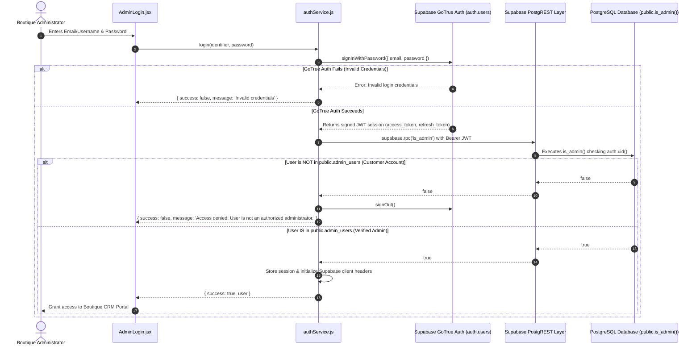

# RODHE — Administrator Authentication Migration Report

**Document Reference**: `docs/ADMIN_AUTH_MIGRATION_REPORT.md`  
**Phase**: Phase S0 (Priority 1 & Priority 2)  
**Date**: November 8, 2026  
**Auditor**: Application Security Engineering Team  

---

## 1. Vulnerability Analysis of Legacy Implementation

The previous implementation in `authService.js` and `AdminLogin.jsx` suffered from four critical vulnerabilities:
1. **Direct Password Table Query**: Directly queried plaintext passwords on `public.admin_users` over the public REST API.
2. **Client-Side Fake Tokens**: Generated arbitrary strings `token: rodhe_token_${Date.now()}` stored in `localStorage`, which carried zero cryptographic validity with Supabase.
3. **Hardcoded Recovery Secrets**: Master bypass keys (`RODHE-2026`, `RODHE-MAISON-2026`, `WOVEN2026`) were bundled directly into public client JavaScript.
4. **Editable Local Roles**: The CRM checked `sessionUser.role === 'super_admin'` from `localStorage`, allowing any user with Chrome DevTools to set `localStorage.setItem('rodhe_admin_session', JSON.stringify({ role: 'super_admin' }))` and view the CRM interface.

---

## 2. Target Architecture: Genuine Supabase Auth



---

## 3. Server-Side Verifiable Authorization Function

To ensure that ordinary customer accounts (or users who manipulate client-side state) cannot access the CRM or read private store data, authorization is verified at the database layer using a `SECURITY DEFINER` function:

```sql
CREATE OR REPLACE FUNCTION public.is_admin()
RETURNS BOOLEAN
LANGUAGE sql
SECURITY DEFINER
SET search_path = public
STABLE
AS $$
  SELECT EXISTS (
    SELECT 1 FROM public.admin_users au
    WHERE (au.user_id = auth.uid() OR au.email = (SELECT email FROM auth.users WHERE id = auth.uid()))
  );
$$;
```

### Why this is mathematically and architecturally tamper-proof:
1. **`auth.uid()` is Extracted from the Cryptographic JWT**: The user's identity is verified by Supabase using the HMAC/RSA signature of the JWT. The client cannot spoof `auth.uid()`.
2. **`SECURITY DEFINER`**: Evaluates directly in PostgreSQL with elevated privileges to check `public.admin_users` without granting public read access to the table.
3. **No Service-Role Key Needed in Frontend**: The frontend uses only the standard public publishable anon key. All administrative operations are authorized through the authenticated user's JWT.
4. **Automatic RLS Integration**: Every RLS policy on `orders`, `order_items`, `payments`, and `admin_users` calls `public.is_admin()`. If an ordinary customer attempts to query the admin API, PostgreSQL returns 0 rows.

---

## 4. Secure Password Recovery Flow

All hardcoded recovery keys are permanently deleted. Password resets are handled strictly through GoTrue email verification:

```javascript
// Implementation in authService.js
async requestPasswordReset(email) {
  const cleanEmail = (email || '').trim().toLowerCase();
  if (!cleanEmail) {
    return { success: false, message: 'Please provide your registered administrative email.' };
  }

  const { error } = await supabase.auth.resetPasswordForEmail(cleanEmail, {
    redirectTo: `${window.location.origin}/#admin-reset`
  });

  if (error) {
    return { success: false, message: error.message };
  }

  return {
    success: true,
    message: 'A secure password recovery link has been dispatched to your email address.'
  };
}
```

