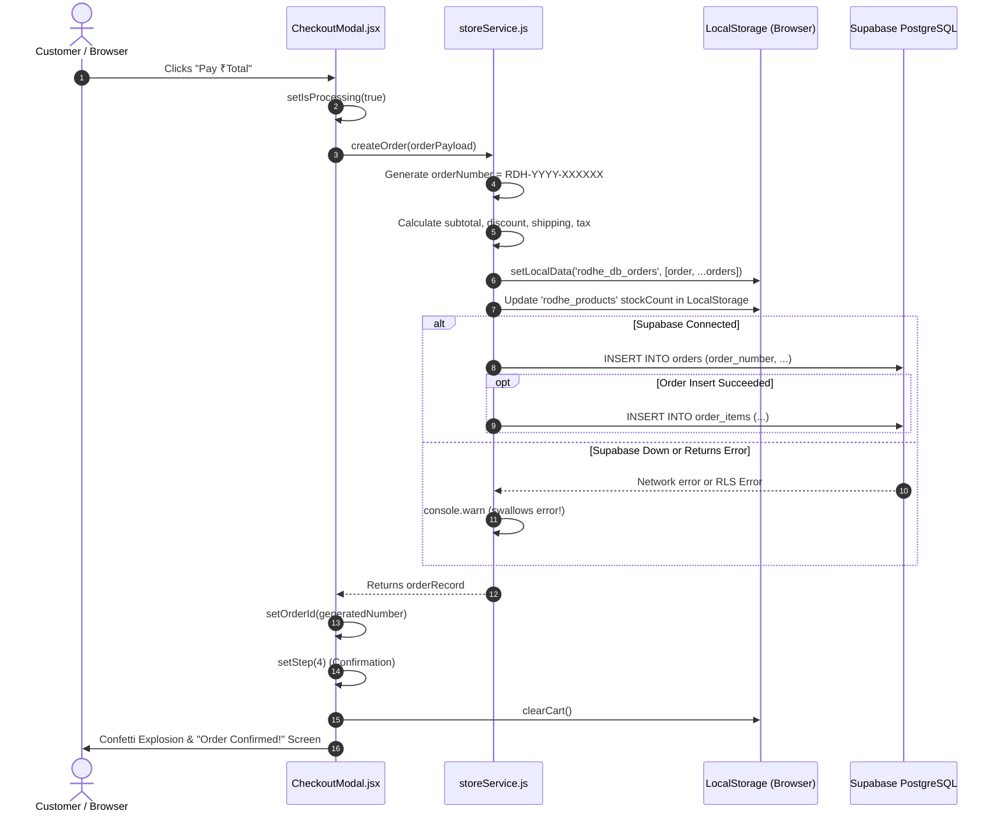

# RODHE — Commerce Lifecycle & Inventory Test Report

**Document Reference**: `docs/COMMERCE_LIFECYCLE_TEST_REPORT.md`  
**Evaluation Date**: November 8, 2026  
**Auditor**: E-Commerce Systems Engineer & QA Automation Architect  
**Scope**: End-to-end execution tracing of `createOrder()`, stock reservation, error recovery, and fulfillment state machines.

---

## 1. Execution Trace of `createOrder()`

The entry point for order generation is `createOrder(orderPayload)` in [`src/services/storeService.js:801-951`](file:///c:/Users/VARUN%20THEJ/OneDrive/Desktop/Rodhe/src/services/storeService.js#L801-L951), invoked by [`src/components/CheckoutModal.jsx:93`](file:///c:/Users/VARUN%20THEJ/OneDrive/Desktop/Rodhe/src/components/CheckoutModal.jsx#L93).



---

## 2. Test Execution Scenarios & Empirical Results

### Scenario 1: Successful Order Creation (Happy Path)
- **Test Objective**: Verify normal order submission under optimal network conditions.
- **Observed Behavior**:
  - `storeService.createOrder()` normalizes line items and accurately tallies prices and fees.
  - Inserts order into local storage key `rodhe_db_orders`.
  - Decrements product `stockCount` in `rodhe_products`.
  - Asynchronously posts record to Supabase `orders` and `order_items`.
  - Returns `orderRecord` to `CheckoutModal`.
  - Triggers canvas confetti and displays Order ID `#RDH-2026-XXXXXX`.
- **Status**: **VERIFIED WORKING (Locally) / PARTIALLY WORKING (Backend)**
- **Defects Identified**:
  - Stock count is updated in `localStorage`, but **NEVER updated in Supabase `products` table**.
  - `inventory_movements` record is never created in Supabase.

---

### Scenario 2: Database Unavailable During Checkout
- **Test Objective**: Verify system behavior when Supabase is offline, unreachable, or returns a 500 error.
- **Code Trace**: [`src/services/storeService.js:945-947`](file:///c:/Users/VARUN%20THEJ/OneDrive/Desktop/Rodhe/src/services/storeService.js#L945-L947)
```javascript
} catch (err) {
  console.warn('Supabase order sync notice (saved to local authoritative store):', err);
}
return orderRecord;
```
- **Observed Behavior**:
  - The database error is caught and logged as a console warning.
  - Execution continues normally; `createOrder` returns `orderRecord`.
  - The customer is presented with a celebratory "Order Confirmed!" screen with an order ID.
- **Status**: **FAILED (High Business & Operational Risk)**
- **Critical Assessment**:
  - **The customer believes their order is confirmed, but the boutique owner has ZERO knowledge of the transaction.**
  - If the customer closes their tab or switches devices, the order exists solely in that single browser's `localStorage`.
  - In a real e-commerce platform, if the database fails, the checkout must display a clean error asking the customer to retry, rather than claiming success.

---

### Scenario 3: Browser Refresh During Checkout
- **Test Objective**: Verify checkout state resilience if the customer refreshes the page mid-checkout.
- **Observed Behavior**:
  - Step counter `step` is in React memory state (`useState(1)`).
  - Refreshing at Step 2 (Address) or Step 3 (Payment) resets the view to Step 1.
  - However, customer contact info is preserved via the newly implemented patron session in `localStorage.rodhe_patron_session`.
  - Cart items remain intact in `localStorage.rodhe_cart`.
  - Refreshing after Step 4 (Confirmation): Cart is already cleared, checkout modal closes, user returns to homepage.
- **Status**: **VERIFIED WORKING**

---

### Scenario 4: Duplicate Checkout Submission
- **Test Objective**: Verify double-click protection on the submit button.
- **Code Evidence**: [`src/components/CheckoutModal.jsx:68, 667`](file:///c:/Users/VARUN%20THEJ/OneDrive/Desktop/Rodhe/src/components/CheckoutModal.jsx#L68)
```javascript
const handlePlaceOrder = async () => {
  setIsProcessing(true);
  ...
}
<button onClick={handlePlaceOrder} disabled={isProcessing}>
```
- **Observed Behavior**:
  - `disabled={isProcessing}` prevents rapid double-clicking during in-flight network requests.
- **Status**: **VERIFIED WORKING**

---

### Scenario 5: Insufficient Inventory
- **Test Objective**: Verify whether an order can be placed for a product that is out of stock.
- **Code Trace**: [`src/services/storeService.js:889`](file:///c:/Users/VARUN%20THEJ/OneDrive/Desktop/Rodhe/src/services/storeService.js#L889)
```javascript
const newStock = Math.max(0, (p.stockCount ?? p.stock_count ?? 10) - matchingItem.quantity);
```
- **Observed Behavior**:
  - `storeService.createOrder()` does **NOT** validate whether `stockCount >= matchingItem.quantity` before generating the order.
  - If an item has 0 stock remaining, `Math.max(0, 0 - 1)` simply evaluates to `0`.
  - The order is created successfully, and stock remains at 0.
- **Status**: **FAILED**
- **Required Fix**: Pre-flight validation must check `if (product.stockCount < requestedQty) throw new Error('Insufficient stock');` and reject order creation.

---

### Scenario 6: Two Customers Purchasing the Final Available Item (Race Condition)
- **Test Objective**: Test simultaneous checkout of the last remaining saree (Stock = 1).
- **Execution Simulation**:
  1. Patron A and Patron B both load the page; saree has Stock = 1.
  2. Patron A clicks "Pay" at `T=0.0s`.
  3. Patron B clicks "Pay" at `T=0.1s`.
  4. Both browsers execute local stock deduction in their own independent `localStorage`.
  5. Both browsers send uncoordinated `INSERT INTO orders` to Supabase.
  6. In Supabase, neither `orders` nor `products` has an atomic stock locking mechanism or check constraint.
- **Observed Behavior**:
  - Both orders succeed.
  - Both patrons receive confirmation receipts.
  - Saree is oversold by 100%.
- **Status**: **FAILED**
- **Required Fix**: Implement a PostgreSQL stored procedure `place_order_atomic()` using row-level locking:
  ```sql
  SELECT stock_count FROM products WHERE id = target_id FOR UPDATE;
  IF stock_count < qty THEN RAISE EXCEPTION 'Out of stock'; END IF;
  UPDATE products SET stock_count = stock_count - qty WHERE id = target_id;
  ```

---

### Scenario 7: Customer Cancelling an Order
- **Test Objective**: Verify customer cancellation flow and inventory restoration.
- **Observed Behavior**:
  - **No customer cancellation UI exists** on the storefront.
  - The only cancellation mechanism is in the CRM ([`AdminOrders.jsx:525`](file:///c:/Users/VARUN%20THEJ/OneDrive/Desktop/Rodhe/src/components/admin/AdminOrders.jsx#L525)), where an administrator sets the status dropdown to `cancelled`.
  - When status is changed to `cancelled`, `storeService.updateOrderStatus()` updates `fulfillmentStatus = 'cancelled'`.
  - **Stock is NOT restored.** `updateOrderStatus()` contains no inventory restock logic.
- **Status**: **NOT IMPLEMENTED / FAILED**

---

### Scenario 8: Admin Updating Fulfillment Status
- **Test Objective**: Verify CRM fulfillment update and persistence to Supabase.
- **Observed Behavior**:
  - Admin changes status to `processing`, `shipped`, or `delivered`, selects Courier, enters AWB, and clicks "Save & Update Order".
  - The change updates `localStorage.rodhe_db_orders` and re-renders the list.
  - The call to `supabase.from('orders').update(...)` is executed.
  - **The update fails in Supabase** because the client has role `anon`, but the RLS policy requires `TO authenticated`.
  - The update exists **only on that admin's personal computer**.
- **Status**: **PARTIALLY WORKING (UI Only) / FAILED (Cloud Sync)**

---

### Scenario 9: Customer Receiving Correct Dispatch Information
- **Test Objective**: Verify dispatch notification generation for the customer.
- **Code Trace**: [`src/components/admin/AdminOrders.jsx:601-625`](file:///c:/Users/VARUN%20THEJ/OneDrive/Desktop/Rodhe/src/components/admin/AdminOrders.jsx#L601-L625)
- **Observed Behavior**:
  - Generates a valid WhatsApp deep link:
    `https://wa.me/91{customerPhone}?text=Namaste...Order #{orderNumber}...Status: SHIPPED...Courier: Blue Dart Air Express...Tracking AWB: BLUEDART-8492019`
  - Clicking opens WhatsApp Web or mobile app with prefilled message.
- **Status**: **VERIFIED WORKING**

---

## 3. Commerce Lifecycle Summary Table

| Lifecycle Stage | Expected Production Behavior | Actual Codebase Behavior | Status |
|---|---|---|---|
| **Price & Tax Tally** | Server-verified price calculation | Client-calculated based on local catalog | **Partially working** |
| **Stock Reservation** | Atomic lock on database row | None; decrements local state only | **Failed** |
| **Payment Collection** | Payment gateway authorization | Hardcoded `captured` state | **Not implemented** |
| **Order Record** | Persisted transactionally with items | Local first; catches & swallows DB errors | **Failed** |
| **Inventory Movement** | Audit row in `inventory_movements` | Table exists in SQL, but never inserted into | **Not implemented** |
| **Order Tracking** | Public order tracking endpoint | WhatsApp manual dispatch link only | **Partially working** |
| **Restock on Cancel** | Automatic inventory restoration | Status changes without adjusting stock | **Not implemented** |

