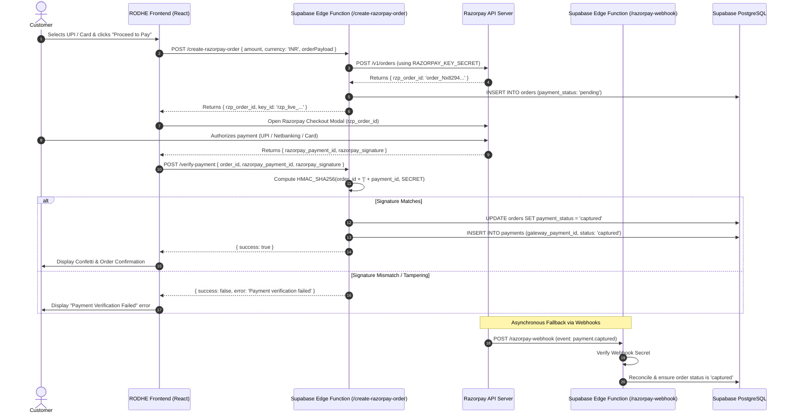

# RODHE — Payment Gateway Readiness & Integration Audit

**Document Reference**: `docs/PAYMENT_READINESS_REPORT.md`  
**Evaluation Date**: November 8, 2026  
**Auditor**: E-Commerce Systems Engineer & Payment Architect  
**Classification**: High-Priority Blocker Report  

---

## 1. Executive Summary

### **PAYMENT GATEWAY INTEGRATION: NOT IMPLEMENTED**

Following a rigorous forensic audit of the entire codebase (`src/`, `package.json`, `index.html`, and server configurations), **no actual payment gateway integration exists in the RODHE application.**

### Critical Findings:
1. **Zero Gateway Libraries**: Neither the Razorpay Standard Checkout SDK (`razorpay`), Cashfree SDK (`cashfree-pg`), PayU, nor Stripe is installed in `package.json` or loaded via `<script>` tags in `index.html`.
2. **Simulated Payment Capture**: In [`src/services/storeService.js:868`](file:///c:/Users/VARUN%20THEJ/OneDrive/Desktop/Rodhe/src/services/storeService.js#L868), selecting "UPI", "Credit/Debit Card", or "Net Banking" sets the order's `paymentStatus` directly to `'captured'` without processing any monetary charge.
3. **No Server-Side Order Creation**: There is no backend endpoint or Supabase Edge Function to securely call the payment gateway's Orders API using a private API secret.
4. **No Signature Verification**: No cryptographic verification (HMAC-SHA256) exists to validate payment signatures returned from gateway checkout handlers.
5. **No Webhook Infrastructure**: No webhook endpoints exist to handle asynchronous payment success, failures, chargebacks, or refunds.

---

## 2. Forensic Code Evidence

### 2.1 Code Inspection: `package.json`
```json
"dependencies": {
  "@supabase/ssr": "^0.12.7",
  "@supabase/supabase-js": "^2.118.0",
  "canvas-confetti": "^1.9.4",
  "gsap": "^3.15.0",
  "lucide-react": "^1.59.0",
  "react": "^19.3.1",
  "react-dom": "^19.3.1"
}
```
*Result: Zero payment aggregator packages are present.*

### 2.2 Code Inspection: `src/components/CheckoutModal.jsx:654`
```jsx
<div style={{ fontSize: '0.78rem', color: '#8F7263', marginTop: '0.5rem' }}>
  <strong style={{ color: '#4B3024' }}>Sandbox Notice:</strong> Verified Concierge Mode active. Production connects to Razorpay via <code>VITE_RAZORPAY_KEY_ID</code>.
</div>
```
*Result: The UI explicitly notes that real Razorpay integration is pending.*

### 2.3 Code Inspection: `src/services/storeService.js:868`
```javascript
// Simulated payment status assignment in createOrder():
paymentStatus: orderPayload.paymentMethod === 'cod' ? 'pending_cod' : 'captured',
payment_status: orderPayload.paymentMethod === 'cod' ? 'pending_cod' : 'captured',
```
*Result: Non-COD orders are marked as captured immediately upon form submission with zero payment verification.*

---

## 3. Production Readiness Evaluation Matrix

| Capability | Requirement | Current Status | Impact / Risk |
|---|---|---|---|
| **Client-Side SDK** | Razorpay / Cashfree script loaded | **Not implemented** | No payment modal or UPI intent can be presented to patron. |
| **Server-Side Order Creation** | Gateway order ID generated via private API key | **Not implemented** | Client cannot open authorized payment session. |
| **Signature Verification** | HMAC-SHA256 hash validation of `razorpay_signature` | **Not implemented** | Vulnerable to client-side request forgery; fraudulent orders could be created. |
| **Webhook Handler** | Idempotent webhook receiver (`payment.captured`) | **Not implemented** | Drops in customer connection will lose payment confirmation status. |
| **Failed Payment Handling** | Order marked `failed` when customer card is declined | **Not implemented** | Customers receive "Order Confirmed" even if transaction fails. |
| **COD Workflow** | Cash on delivery marked `pending_cod` | **Verified working** | Correctly distinguishes COD status from electronic payments. |
| **Payment Reconciliation** | Gateway transaction ID stored in `payments` table | **Not implemented** | Table exists in SQL, but zero rows are written. |

---

## 4. Required Production Payment Architecture (Razorpay Standard)

To transition from the current simulated checkout to real commerce, the following standard architecture must be implemented:



---

## 5. Implementation Roadmap for Payment Readiness

1. **Step 1: Obtain Production Merchant Credentials**
   - Register on [Razorpay](https://razorpay.com/) or [Cashfree Payments](https://www.cashfree.com/).
   - Complete KYC and obtain:
     - `RAZORPAY_KEY_ID` (Public, frontend-safe)
     - `RAZORPAY_KEY_SECRET` (Private, server-only)
     - `RAZORPAY_WEBHOOK_SECRET` (Private, server-only)
2. **Step 2: Deploy Supabase Edge Functions**
   - Create `supabase/functions/create-razorpay-order/index.ts`.
   - Create `supabase/functions/verify-razorpay-signature/index.ts`.
   - Store private secrets in Supabase Secrets vault (`supabase secrets set RAZORPAY_KEY_SECRET=...`).
3. **Step 3: Update `CheckoutModal.jsx`**
   - Inject `<script src="https://checkout.razorpay.com/v1/checkout.js"></script>`.
   - Call `/create-razorpay-order` before opening the modal.
   - Await signature verification before displaying order confirmation.
4. **Step 4: Stop Simulating Payments**
   - Remove hardcoded `'captured'` status from `storeService.js`.

