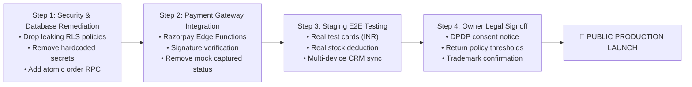

# RODHE — Production Launch Checklist & Go-Live Criteria

**Document Reference**: `docs/PRODUCTION_LAUNCH_CHECKLIST.md`  
**Evaluation Date**: November 8, 2026  
**Auditor**: Principal Software Architect & Product Operations Lead  
**Launch Status**: **BLOCKED — REMEDIATION REQUIRED**

---

## 1. Production Launch Gate Criteria

Before public DNS redirection to `rodhe.in` or running marketing campaigns, all **P0 Blockers** must be signed off by the engineering and business leadership.

```
┌─────────────────────────────────────────────────────────────┐
│                 RODHE GO-LIVE READINESS STATUS              │
├────────────────────────────────┬────────────────────────────┤
│ 1. Frontend UI / UX / Styling  │ 🟢 95% READY (Passed)      │
│ 2. Catalog & Textile Provenance│ 🟢 100% READY (Passed)     │
│ 3. Database Schema DDL         │ 🟡 80% READY (Fix RLS)     │
│ 4. Authentication Architecture │ 🔴 BLOCKED (High Risk)     │
│ 5. Payment Gateway Integration │ 🔴 BLOCKED (Not Installed) │
│ 6. Real Order Cloud Persistence│ 🔴 BLOCKED (Sync Fails)    │
│ 7. Legal & Compliance Signoff  │ 🟡 PENDING OWNER REVIEW    │
└────────────────────────────────┴────────────────────────────┘
```

---

## 2. Actionable Launch Checklist

### Category A: Payment Gateway Integration (P0 — Critical Blocker)
- [ ] **A.1 Merchant Onboarding**: Complete corporate KYC with Razorpay or Cashfree. *(Status: BLOCKED | Owner: Business Owner)*
- [ ] **A.2 Edge Function Setup**: Deploy `create-razorpay-order` on Supabase Edge with `RAZORPAY_KEY_SECRET`. *(Status: NOT IMPLEMENTED | Owner: Backend Architect)*
- [ ] **A.3 Signature Verification**: Deploy `verify-razorpay-signature` validating HMAC-SHA256 signatures before confirming orders. *(Status: NOT IMPLEMENTED | Owner: Security Engineer)*
- [ ] **A.4 Webhook Handler**: Deploy `razorpay-webhook` listening for `payment.captured` and `payment.failed`. *(Status: NOT IMPLEMENTED | Owner: Backend Architect)*
- [ ] **A.5 Eliminate Simulation**: Remove hardcoded `paymentStatus = 'captured'` in `storeService.js:868`. *(Status: BLOCKED | Owner: Frontend Lead)*

### Category B: Authentication & Security Hardening (P0 — Critical Blocker)
- [ ] **B.1 Eradicate Hardcoded Keys**: Remove `RODHE-2026`, `RODHE-MAISON-2026`, `WOVEN2026` from `authService.js:132`. *(Status: BLOCKED | Owner: Security Engineer)*
- [ ] **B.2 Implement Supabase Auth for Admins**: Provision administrative emails in `auth.users` and authenticate via `supabase.auth.signInWithPassword`. *(Status: BLOCKED | Owner: Security Engineer)*
- [ ] **B.3 Revoke Public Credentials Policy**: Drop `"Allow Login Verification"` policy from `public.admin_users` table. *(Status: BLOCKED | Owner: Database Architect)*
- [ ] **B.4 Secure Password Reset**: Replace custom reset with official Supabase password reset magic links (`supabase.auth.resetPasswordForEmail`). *(Status: BLOCKED | Owner: Fullstack Engineer)*
- [ ] **B.5 Protect Customer PII**: Replace `USING (true)` on `public.orders` with restricted customer/admin lookup policies. *(Status: BLOCKED | Owner: Database Architect)*

### Category C: Database & Migrations (P0 — Critical Blocker)
- [ ] **C.1 Idempotent Migrations**: Add `DROP POLICY IF EXISTS` guards to all policies in `supabase/migrations/20261108_commerce_core.sql`. *(Status: BLOCKED | Owner: Database Architect)*
- [ ] **C.2 Sequential Order Sequence**: Implement PostgreSQL sequence `rodhe_order_seq` to eliminate `Math.random()` collision risks. *(Status: BLOCKED | Owner: Database Architect)*
- [ ] **C.3 Atomic Order Placement RPC**: Implement `create_order_atomic()` stored procedure wrapping order creation, inventory deduction, and movement audit in a single `FOR UPDATE` transaction. *(Status: BLOCKED | Owner: Database Architect)*
- [ ] **C.4 CRM Update Permission**: Grant `UPDATE` privileges on `public.orders` to authenticated administrators. *(Status: BLOCKED | Owner: Database Architect)*

### Category D: Inventory & Commerce Reliability (P1 — High Priority)
- [ ] **D.1 Cloud Stock Deduction**: Ensure `public.products.stock_count` is decremented in Supabase on order creation. *(Status: BLOCKED | Owner: Backend Architect)*
- [ ] **D.2 Out-of-Stock Guard**: Block checkout if `stock_count < requested_qty`. *(Status: BLOCKED | Owner: Frontend Lead)*
- [ ] **D.3 Restock on Cancellation**: Implement inventory restoration in `storeService.updateOrderStatus` when an order is cancelled. *(Status: NOT IMPLEMENTED | Owner: Fullstack Engineer)*
- [ ] **D.4 Graceful DB Degradation**: Replace silent swallow in `storeService.js:945` with explicit error notifications to the customer if database writes fail. *(Status: BLOCKED | Owner: Frontend Lead)*

### Category E: Legal & Statutory Compliance (P1 — Owner Signoff)
- [ ] **E.1 DPDP Act 2023 Review**: Review customer data collection and verify compliance with Sections 8 & 9 of the DPDP Act. *(Status: PENDING REVIEW | Owner: Legal Counsel / Owner)*
- [ ] **E.2 Courier Insurance Verification**: Verify active insurance riders with Blue Dart / Delhivery before advertising 100% insured transit. *(Status: PENDING REVIEW | Owner: Operations Lead)*
- [ ] **E.3 Reverse Pickup Margins**: Confirm whether 100% complimentary reverse pickup for non-defective returns is viable on sarees under ₹1,200. *(Status: PENDING REVIEW | Owner: Business Owner)*
- [ ] **E.4 Trademark Clearance**: Confirm trademark filing status for RODHE™ with the Indian Trade Marks Registry. *(Status: PENDING REVIEW | Owner: Legal Counsel)*

### Category F: Production Infrastructure & Monitoring (P2 — Operational)
- [ ] **F.1 Custom Domain & SSL**: Configure DNS records for `rodhe.in` with HTTPS certificates on Vercel/Netlify. *(Status: READY FOR DEPLOYMENT | Owner: DevOps)*
- [ ] **F.2 Error Logging**: Integrate Sentry or LogRocket for real-time client-side exception telemetry. *(Status: NOT IMPLEMENTED | Owner: DevOps)*
- [ ] **F.3 Supabase Production Compute**: Ensure Supabase project is on a Pro tier with daily automated backups. *(Status: PENDING OWNER SUBSCRIPTION | Owner: Business Owner)*

---

## 3. Recommended Phased Execution Plan



### Immediate Next Action:
Present this report to the project owner for sign-off. Once authorized, proceed to **Step 1: Security & Database Remediation** and **Step 2: Payment Gateway Integration**.

