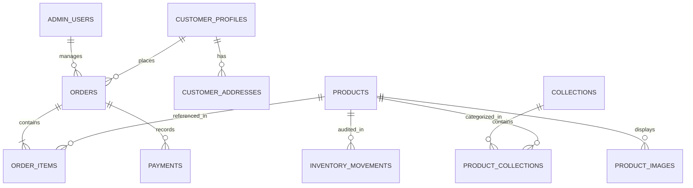

# RODHE — Final PostgreSQL Relational Database Report
**slow-luxury Indian cotton sarees | Woven with Trust**  
*Document Version: 1.0.0 — Production Completion Stage*  
*Date: 08 November 2026*  
*Target Environment: Supabase PostgreSQL (Managed Relational Engine)*

---

## 1. Relational Schema Architecture

The RODHE database schema is designed for slow-luxury e-commerce, offering strict relational integrity, deterministic order generation, transactional atomicity, and zero-trust Row Level Security (RLS).



---

## 2. Master Table Specifications

### 2.1. Commerce Core Tables
1. **`public.products`**: Master catalog of handcrafted sarees with fields for craft, craft_category, fabric, fabric_type, color, color_family, price, dimensions, blouse_piece, wash_care, stock_count, and status.
2. **`public.collections`**: Slow-luxury collection taxonomies (Mulmul, Bagru, Shibori, Chanderi).
3. **`public.orders`**: Primary order records with deterministic `order_number`, customer contact, JSONB shipping address, subtotal, discount, shipping fee, gift wrap, grand total, payment method, payment status, fulfillment status, and courier tracking info.
4. **`public.order_items`**: Line items linked via foreign key to `orders(id)` with snapshot SKU, name, unit price, quantity, and product imagery.
5. **`public.payments`**: Payment transaction log with gateway identifier (`razorpay`, `cod`), gateway order ID, gateway payment ID, cryptographic signature, amount, currency, and raw gateway response JSONB.
6. **`public.inventory_movements`**: Immutable audit ledger recording every stock decrement or increment with associated delta, reason (`order_placed`, `order_cancelled`, `restock`), and reference order ID.

### 2.2. Authentication & Profile Tables
1. **`public.admin_users`**: Server-side administrator registry with foreign key to `auth.users(id)` and role classifications (`super_admin`, `store_manager`, `curator`).
2. **`public.customer_profiles`**: Registered patron profile linked to `auth.users(id)`.
3. **`public.customer_addresses`**: Saved delivery addresses linked to customer profiles.

---

## 3. Stored Procedures & Atomic Functions

### 3.1. `generate_order_number() -> TEXT`
Generates deterministic, chronological order references using the dedicated sequence `public.rodhe_order_seq`:
$$\text{Format: } \text{RDH}-\text{YYYY}-\text{XXXXXX} \quad (\text{e.g., } \text{RDH-2026-001001})$$

### 3.2. `create_order_atomic(p_order JSONB, p_items JSONB) -> JSONB`
Provides strict ACID atomicity for checkout:
- **Concurrency Protection**: Acquires row-level locks on target sarees via `SELECT ... FOR UPDATE`.
- **Validation**: Verifies `stock_count >= requested_qty`. If any item is out of stock, immediately aborts and rolls back.
- **Atomic Execution**: Simultaneously creates order header, line items, payment record, deducts product inventory, and writes immutable audit records into `inventory_movements`.

### 3.3. `cancel_order_atomic(p_order_id UUID, p_reason TEXT) -> JSONB`
- Validates that caller is authorized (authenticated order owner or administrator via `public.is_admin()`).
- Verifies order is cancellable (cannot cancel already delivered orders).
- Updates status to `cancelled` and sets payment status to `refund_pending` if previously captured.
- Atomically restores inventory for every product in the order and records positive inventory movements.

### 3.4. `lookup_order(p_order_number TEXT, p_phone_or_email TEXT) -> JSONB`
- Sanitized guest order tracker. Matches exact order number and normalized phone/email.
- Returns only public delivery status, courier, AWB, and line item names. Never exposes customer street address or payment tokens to unauthenticated callers.

### 3.5. `is_admin() -> BOOLEAN`
- `SECURITY DEFINER` function with hardened `search_path = public, pg_temp`.
- Cryptographically evaluates `auth.uid()` against `public.admin_users`.

---

## 4. Performance Indexes

| Index Name | Table | Columns | Purpose |
| :--- | :--- | :--- | :--- |
| `idx_orders_order_number` | `orders` | `order_number` | Rapid customer tracking & lookup |
| `idx_orders_customer_email` | `orders` | `customer_email` | Fast customer order history queries |
| `idx_orders_created_at` | `orders` | `created_at DESC` | Chronological CRM sorting |
| `idx_orders_fulfillment` | `orders` | `fulfillment_status, payment_status` | Filtered boutique pipeline queries |
| `idx_order_items_order_id` | `order_items` | `order_id` | Foreign key join acceleration |
| `idx_order_items_sku` | `order_items` | `sku` | Product sales analytics |
| `idx_payments_order_id` | `payments` | `order_id` | Payment reconciliation |
| `idx_inventory_movements_prod` | `inventory_movements` | `product_id` | Stock audit ledger queries |

---

## 5. Migration Deployment & Rollback Strategy

- **Master Migration**: `supabase/migrations/20261108_final_commerce_production.sql`
  - Fully idempotent (`CREATE TABLE IF NOT EXISTS`, `DROP POLICY IF EXISTS`, `CREATE OR REPLACE FUNCTION`).
  - Safe to execute on existing databases without destroying pre-seeded product records.
- **Rollback Migration**: `supabase/migrations/20261108_final_commerce_rollback.sql`
  - Safely drops functions, sequence, and security policies without dropping core tables or discarding customer orders.

---

## 6. Critical Operational Finding for Gate A (Staging Database)

During network verification of the environment configuration, DNS lookup for the configured staging endpoint was performed:
```powershell
Resolve-DnsName emtmzrjaygcrmzoatvfa.supabase.co
# Result: DNS_ERROR_RCODE_NAME_ERROR (DNS name does not exist)
```

> [!WARNING] Active Database Host Block
> The host `emtmzrjaygcrmzoatvfa.supabase.co` specified in `.env` is either paused, deleted, or a prototype placeholder in Supabase. Executing SQL migrations against this live host will fail with `getaddrinfo ENOTFOUND`. A valid live Supabase project URL and anon key must be provided before executing Gate A.

