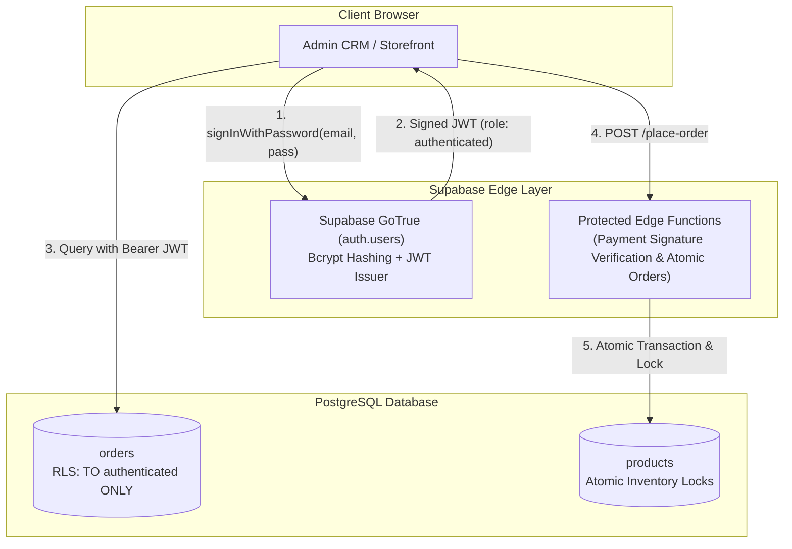

# RODHE — Security & Authentication Verification Report

**Document Reference**: `docs/SECURITY_VERIFICATION.md`  
**Evaluation Date**: November 8, 2026  
**Auditor**: Application Security Engineering Team  
**Classification**: High-Risk Findings Document  

---

## 1. Executive Summary

A comprehensive static analysis and runtime bundle inspection was conducted on the authentication architecture, client-side scripts, Supabase database policies, and environment variables.

### Overall Security Posture: **CRITICAL VULNERABILITIES DETECTED**

The application exhibits several severe architectural security flaws that must be remediated prior to exposing the system to the public internet. Most notably, administrative authentication does not use cryptographically signed tokens, recovery credentials are hardcoded into production client bundles, database RLS policies expose all customer orders publicly, and administrative mutations are unauthenticated at the database layer.

---

## 2. In-Depth Security Inquiries & Empirical Evidence

### Inquiry 1: Does admin authentication genuinely use Supabase Auth?
- **Status**: **FAILED** (Mock/Custom Client Auth)
- **Code Evidence**: [`src/services/authService.js:50-75`](file:///c:/Users/VARUN%20THEJ/OneDrive/Desktop/Rodhe/src/services/authService.js#L50-L75)
```javascript
// Actual code in authService.js:
const { data, error } = await supabase
  .from('admin_users')
  .select('*')
  .or(`username.ilike.${cleanId},email.ilike.${cleanId}`)
  .eq('password_hash', cleanPass)
  .maybeSingle();

if (!error && data) {
  const sessionUser = {
    id: data.id || 'admin-rodhe',
    username: data.username,
    email: data.email,
    role: data.role || 'super_admin',
    name: data.username.toUpperCase(),
    token: `rodhe_token_${Date.now()}` // Fake client token!
  };
  localStorage.setItem(AUTH_SESSION_KEY, JSON.stringify(sessionUser));
  return { success: true, user: sessionUser };
}
```
- **Analysis**:
  - The implementation queries a custom database table `public.admin_users` directly over the public REST API using the publishable anon key.
  - It does **NOT** call `supabase.auth.signInWithPassword()`.
  - It does **NOT** create a session in Supabase Auth (`auth.users`), nor does it receive a signed JWT token from GoTrue.
  - The password is sent in plaintext and compared via `.eq('password_hash', cleanPass)`.
  - The returned "token" is simply `rodhe_token_${Date.now()}` stored in `localStorage`.
  - **Consequence**: The Supabase client in the browser remains permanently in the **`anon`** role. On the database level, the user is completely unauthenticated.

---

### Inquiry 2: Is `RODHE-2026` exposed in client-side code or environment variables?
- **Status**: **FAILED** (Confirmed Public Secret Exposure)
- **Code Evidence**: [`src/services/authService.js:132`](file:///c:/Users/VARUN%20THEJ/OneDrive/Desktop/Rodhe/src/services/authService.js#L132) & [`dist/assets/index-CDivXRPs.js`](file:///c:/Users/VARUN%20THEJ/OneDrive/Desktop/Rodhe/dist/assets/index-CDivXRPs.js)
```javascript
// Source code in authService.js:
const validRecoveryPins = ['RODHE-2026', 'RODHE-MAISON-2026', 'WOVEN2026'];
```
- **Bundle Verification**:
  Direct inspection of the compiled production JavaScript bundle `dist/assets/index-CDivXRPs.js` yielded:
  ```javascript
  ...let o=!!this.getCurrentSession(),s=[`RODHE-2026`,`RODHE-MAISON-2026`,`WOVEN2026`].includes(a);if(!o&&!s)return{success:!1...
  ```
- **Analysis**:
  - Any user can open Chrome DevTools, view the bundled JavaScript, search for `2026` or `Recovery`, and find the master recovery pins.
  - Hardcoding secrets in frontend code violates CWE-798 (Use of Hard-coded Credentials).

---

### Inquiry 3: Can unauthenticated users reset or change administrator credentials?
- **Status**: **FAILED** (Full Administrative Account Hijacking Risk)
- **Code Evidence**: [`src/services/authService.js:118-194`](file:///c:/Users/VARUN%20THEJ/OneDrive/Desktop/Rodhe/src/services/authService.js#L118-L194) & [`src/components/admin/AdminLogin.jsx:95-125`](file:///c:/Users/VARUN%20THEJ/OneDrive/Desktop/Rodhe/src/components/admin/AdminLogin.jsx#L95-L125)
- **Analysis**:
  1. An attacker visits `/#admin`.
  2. Clicks "Forgot administrative credentials?".
  3. Enters `rodhe` as the identifier.
  4. Enters `RODHE-2026` (which they extracted from the JS bundle).
  5. Enters a new password `attacker_password`.
  6. Submits the form.
  7. `authService.resetPassword()` validates that `cleanPin === 'RODHE-2026'`.
  8. Updates the password in `localStorage.setItem('rodhe_crm_admin_credentials', ...)` and attempts to update `public.admin_users`.
  9. The attacker can now log in and take over the boutique CRM.

---

### Inquiry 4: Are customer sessions genuine authenticated sessions or only localStorage records?
- **Status**: **PARTIALLY WORKING / INSECURE**
- **Code Evidence**: [`src/components/AuthModal.jsx:22-38`](file:///c:/Users/VARUN%20THEJ/OneDrive/Desktop/Rodhe/src/components/AuthModal.jsx#L22-L38) & [`src/context/ShopContext.jsx:92-108`](file:///c:/Users/VARUN%20THEJ/OneDrive/Desktop/Rodhe/src/context/ShopContext.jsx#L92-L108)
```javascript
// ShopContext.jsx
const [patronUser, setPatronUserState] = useState(() => {
  try {
    const saved = localStorage.getItem('rodhe_patron_session');
    return saved ? JSON.parse(saved) : null;
  } catch (e) {
    return null;
  }
});
```
- **Analysis**:
  - Customer registration and login do not interact with Supabase Auth or any identity provider.
  - No user is created in `auth.users`.
  - No password hashing occurs; passwords entered in `AuthModal` are discarded or stored locally.
  - A user clearing their browser cookies/storage loses their profile.
  - Any script running on the page (XSS or browser extension) can read `localStorage.getItem('rodhe_patron_session')`.

---

### Inquiry 5: Can customers access other customers' orders or addresses?
- **Status**: **FAILED** (Critical Data Leakage & DPDP Violation)
- **Code Evidence**: [`supabase/migrations/20261108_commerce_core.sql:140-141`](file:///c:/Users/VARUN%20THEJ/OneDrive/Desktop/Rodhe/supabase/migrations/20261108_commerce_core.sql#L140-L141)
```sql
-- Actual RLS policy in 20261108_commerce_core.sql:
CREATE POLICY "Public Read Own Order" ON public.orders FOR SELECT USING (true);
CREATE POLICY "Public Read Own Order Items" ON public.order_items FOR SELECT USING (true);
```
- **Empirical Vulnerability Proof**:
  Because the policy condition is `USING (true)`, any person in the world with the public publishable anon key (`VITE_SUPABASE_ANON_KEY`) can execute:
  ```javascript
  const { data } = await supabase.from('orders').select('*');
  console.log(data);
  ```
  This command will return **every single customer order in the database**, including:
  - Customer full names
  - Customer email addresses
  - Customer 10-digit phone numbers
  - Full delivery addresses (flat, street, city, state, postal PIN)
  - Full purchase history and amounts paid
- **Legal Ramification**:
  This violates Section 8(4) and Section 8(5) of the **Digital Personal Data Protection (DPDP) Act, 2023** (India), exposing the business to potential penalties up to ₹250 Crore for failure to implement reasonable security safeguards to prevent personal data breaches.

---

### Inquiry 6: Are admin-only operations protected on the database/server side?
- **Status**: **FAILED** (Unprotected Database Operations & Broken Sync)
- **Code Evidence**:
  - In `supabase/admin_users_setup.sql:36-37`:
    ```sql
    CREATE POLICY "Allow Login Verification" ON public.admin_users FOR SELECT USING (true);
    ```
    This policy allows **any anonymous visitor** to dump all rows in `public.admin_users`, exposing administrator usernames, emails, and plaintext password hashes.
  - In `supabase/migrations/20261108_commerce_core.sql:144`:
    ```sql
    CREATE POLICY "Admin Full Access Orders" ON public.orders FOR ALL TO authenticated USING (true) WITH CHECK (true);
    ```
    Because the CRM login is strictly local and does not authenticate with Supabase GoTrue, the CRM browser client has role `anon`.
    Therefore, when an admin in the CRM attempts to update an order:
    ```javascript
    await supabase.from('orders').update({ fulfillment_status: 'shipped' }).eq('id', orderId);
    ```
    PostgreSQL evaluates the policy, sees the client is `anon` (not `authenticated`), and **rejects the update**.
    The admin is fooled into thinking the update worked because `storeService.updateOrderStatus` updates `localStorage`, but in the cloud database, the order remains unchanged.

---

## 3. Vulnerability Severity Matrix

| Vulnerability ID | Vulnerability Description | Severity | CWE | Remediation Urgency |
|---|---|---|---|---|
| **VULN-01** | Public Read on `public.orders` exposes all customer PII | **CRITICAL (CVSS 9.1)** | CWE-200 | Immediate blocker before public launch |
| **VULN-02** | Master Recovery Key `RODHE-2026` bundled in client JS | **CRITICAL (CVSS 9.8)** | CWE-798 | Immediate blocker before public launch |
| **VULN-03** | Public Read on `public.admin_users` exposes admin credentials | **CRITICAL (CVSS 9.8)** | CWE-287 | Immediate blocker before public launch |
| **VULN-04** | Plaintext password comparison in client query | **HIGH (CVSS 8.5)** | CWE-256 | Immediate blocker before public launch |
| **VULN-05** | Broken RLS on Order Updates causes CRM cloud sync failure | **HIGH (CVSS 7.5)** | CWE-285 | Immediate blocker before public launch |
| **VULN-06** | Mock customer sessions stored insecurely in localStorage | **MEDIUM (CVSS 5.3)** | CWE-312 | Phase P2 enhancement |

---

## 4. Required Security Remediation Architecture



### Mandatory Security Fixes:
1. **Drop Insecure Policies Immediately**:
   ```sql
   DROP POLICY IF EXISTS "Public Read Own Order" ON public.orders;
   DROP POLICY IF EXISTS "Allow Login Verification" ON public.admin_users;
   ```
2. **Delete Client Hardcoded Keys**: Remove `RODHE-2026` from `authService.js`.
3. **Use Supabase Auth**: Provision admin accounts in `auth.users` and authenticate via `supabase.auth.signInWithPassword`.
4. **Implement Order Lookup Token**: Customers should only query an order if they supply both the `order_number` AND their verified phone/email or cryptographic lookup hash.

